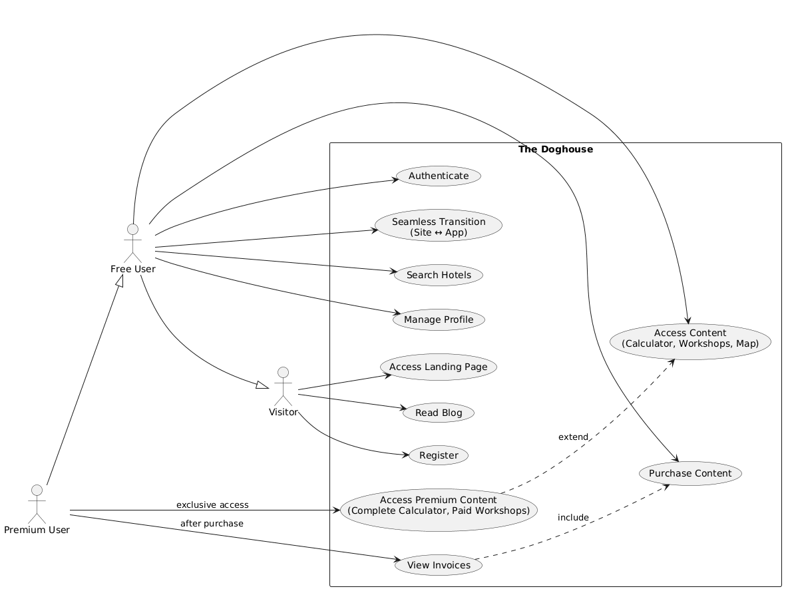

# User Personas and Flows – _The Doghouse_

## 1. Introduction

This document describes who uses **The Doghouse** and the main journeys those people take on the institutional website and in the members’ area. It is grounded in the [frozen decisions in the interview annex](INTERVIEW_ANNEX.md) and must stay consistent with the [Scope](01_SCOPE.md).

The product is a **real product for dog owners**. There is no in-product admin persona in the first version: content is placed directly (files or database). Clinics, shelters, and breeders running their **operations** are out of audience scope.

Business rules that constrain these flows live in [03_BUSINESS_RULES.md](03_BUSINESS_RULES.md).

## 2. User Personas

Access levels at launch: **visitor** → **free member** → **member who paid for something** (annex decision **E**).

### 2.1. Visitor

The visitor uses the institutional website without an account. Goals: understand The Doghouse, read articles, and decide whether to sign up. Access: landing page and articles only — no members’ area features until they sign in.

### 2.2. Free User (free member)

The free user has signed in (email magic link and/or Google or Facebook — exact mix in design) but has not yet bought premium content. Goals: use the free calculator, watch free workshops, explore pet-friendly hotels, and understand what is worth buying. Access: free calculator, free workshops at launch, hotels map/list, profile. Paid content is visible but locked with a clear path to purchase.

### 2.3. Premium User (member who paid)

“Premium” here means **bought one or more items** — not a global subscription. Access is only to what they paid for; everything else stays locked until purchased. Goals: use purchased calculator/workshops, keep lifetime access to those items (no monthly subscription in v1), buy more later, and view receipts/invoices from purchases. Hotels remain available to all signed-in members.

## 3. Usage Flows

### 3.1. Registration and Authentication

A visitor opens the landing page and chooses Member Area / Register. The system offers sign-in options (magic link and/or social login as designed). After success, they land in the members’ area as a Free User with an active session.

### 3.2. Seamless Navigation (Signed-In Members Only)

**Signed-in** free or paying members browsing the site can open the members’ area without signing in again (shared session). Visitors who are **not** signed in still need to sign in. This matches annex decision **F**.

### 3.3. Access to Free Content

A free user opens the members’ area and uses:

- **Calculator (free):** breed + age → approximate ideal weight; prompt to unlock the full version.
- **Workshops (free):** at launch, **2 free** videos, organised by breed.
- **Hotels:** map/list for signed-in members (near me or text search), with open-in-maps when useful.

Paid items stay visible but locked.

### 3.4. Purchase of Premium Content

#### 3.4a. Purchase Initiation

The user tries locked content (full calculator or a paid workshop). The product shows price and Buy. Checkout runs through the payment provider (sandbox/trial acceptable). The user confirms with test or real cards according to the environment.

#### 3.4b. Confirmation, Access, and Receipt

After payment succeeds, the backend records the purchase, unlocks **only** that content for lifetime access, and issues a receipt/invoice in **trial/test mode** if safer for v1 (fully live invoicing can follow later). The members’ area reflects unlocked content on refresh or status check. Webhook retries and client polling may be used so a delayed confirmation does not leave a paid user locked out indefinitely.

At launch, paid workshop inventory is **4 paid** videos, organised by breed. Packaging (single video vs breed-oriented packages) may be refined in design, as long as buyers keep access to what they paid for and there is no v1 monthly subscription.

### 3.5. Using the Calculator

- **Free:** approximate ideal weight for breed and age.
- **Paid full version:** richer output (for example percentiles and recommendations) only for who purchased it. Optional save of results may be added later without changing purchase rules.

### 3.6. Using the Workshops

Workshops are organised **by breed**. Launch set: **2 free** + **4 paid**. Free users watch free videos only. Paying users watch only what they bought (plus free videos). Clear lock/unlock states avoid confusion about access.

### 3.7. Searching for Hotels

Available to all signed-in members. Near-me (with consent) or text place search; results for the current map area; marker details and open in the device’s maps app. Declining geolocation still allows text search.

### 3.8. Viewing Invoices / Receipts

After a successful purchase, the paying user can open receipts/invoices tied to their purchases (trial/test documents acceptable in v1).

### 3.9. Important Failure Cases

- **Expired or invalid magic link:** clear message; allow requesting a new link.
- **Payment declined or timeout:** no unlock; user can retry; no fake invoice.
- **Payment succeeded but confirmation delayed:** retry/polling until purchase is recorded; then unlock.

### 3.10. Time Constants (indicative for design)

- Magic link: short-lived and single use (exact minutes in design; often ~15 minutes).
- Hotel data cache: TTL on the order of a day when caching external map data.
- Session: lasting signed-in session with renew-on-return behaviour as designed (often multi-day JWT).

## 4. Persona to Feature Mapping

| Persona | Can do |
| ------- | ------ |
| Visitor | Landing, articles, start sign-in |
| Free user | Free calculator, 2 free workshops, hotels, profile, start purchase |
| Premium user (per purchase) | Same as free + unlocked paid items they bought + view receipts for those purchases |

## 5. Conclusion

Personas and flows for The Doghouse follow visitor → free member → paying member, with seamless site-to-app only for **signed-in** members, workshops **by breed** at the annex launch counts, and selling with receipt/invoice in v1 (trial/test allowed). Detailed rules are in [03_BUSINESS_RULES.md](03_BUSINESS_RULES.md).

---

## Annex – Use Case Diagram

_Figure 1 – Use Case Diagram of The Doghouse. Actors (Visitor, Free User, Premium User) and main use cases: registration, authentication, free and paid content, purchase, invoice viewing, hotel search, and seamless navigation for signed-in members._
