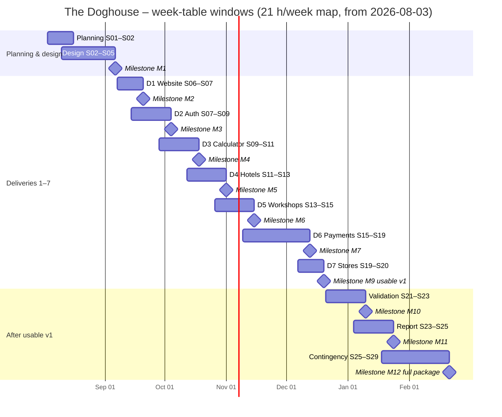

# Schedule (Gantt) – _The Doghouse_

## 1. Introduction

This document turns the [work breakdown](04_WBS.md) (~**591 hours** including contingency) into a **week-by-week proposal calendar**. It is a **reference map**, not a rigid contract: weeks may shift if quality requires; product scope does not change without a new freeze in the interview annex / Scope / business rules.

Granularity: **weeks** (not days). Fine task lists live in a delivery roadmap when implementation of a delivery starts.

**Figure:** Mermaid Gantt below (milestones + major packages). If the figure and the tables disagree, the **tables win**.

---

## 2. Premises

| Item | Value |
| ---- | ----- |
| **Calendar anchor (S01)** | Week of **3 Aug 2026** (Mon **2026-08-03** – Sun **2026-08-09**) |
| **Effort source** | [WBS](04_WBS.md) grand total **~591 h** (subtotal ~505 + contingency 76 + unforeseen 10) |
| **Base capacity** | **3 h/day × up to 7 calendar days** ≈ **21 h/week** (planning reference) |
| Optimistic | **4 h/day** ≈ **28 h/week** |
| Pessimistic | **2 h/day** ≈ **14 h/week** |
| Work | Solo, interleaved with private client work and smaller freelance jobs |
| Audience of this public work | Other engineers and recruiters (public showcase) |
| Stance | Forecast **as if starting from zero** (a live institutional site does not shorten this map) |
| Commerce | Stripe + Moloni **sandbox** in this public project (`RN-19`…`RN-21`); reusers may switch via env |
| Auth / seamless | Magic link and/or Google and/or Facebook; seamless **site ↔ Flutter Web** for signed-in members (`RN-10`…`RN-13`) |
| Workshops | **2 free** + **4 paid** at launch, by breed |
| Brand in UI | **The Doghouse** only (`RN-03`) |

---

## 3. Scenarios and the annex horizon

### 3.1. Full package (~591 h)

| Scenario | h/week | Weeks ≈ | Approx. end (from S01) |
| -------- | ------ | ------- | ---------------------- |
| **Base (3 h/day)** | 21 | **~28–29** | **~mid-Feb 2027** (S29) |
| Optimistic (4 h/day) | 28 | ~21 | ~late Dec 2026 |
| Pessimistic (2 h/day) | 14 | ~42 | ~late May 2027 |

### 3.2. Shared calendar rule (Scope / schedule / proposal report)

**Same sentence everywhere:** work is **solo**. **Usable first version** = Deliveries **1–7** Done when (milestone **M9**, ~**420 h**). Cross-cutting validation (~55 h) is **after** M9. Solo hours add: **420 ÷ 28 ≈ 15 weeks** (~**three and a half months** from S01, week of **9–15 Nov 2026** if capacity stays at 28 h/week); **420 ÷ 21 = 20 weeks** (~**four to five months**, **S20** / 14–20 Dec 2026 on the §5 map). Delivery parallelism may reorder focus; it does **not** reduce solo hours. **Two months** is not a published target. Prefer quality over a harmful rigid date. Client/freelance weeks that drop capacity slip end dates; total effort (~591 h) does not change.

| Checkpoint | Meaning | At 21 h/week (§5 map) | At 28 h/week (hours ÷ rate) |
| ---------- | ------- | --------------------- | --------------------------- |
| **M9 – Usable first version** | Deliveries **1–7** Done when (~420 h) | **S20** (14–20 Dec 2026) ≈ 20 weeks | ≈ **15 weeks** (9–15 Nov 2026) |
| **M10 – Beta hardened** | Validation ~55 h | **S21–S23** | after M9 |
| **M11 – Report & article** | Closure docs | **S23–S25** | after M10 |
| **M12 – Full package** | + contingency (~591 h total) | **S29** (15–21 Feb 2027) ≈ 29 weeks | **591 ÷ 28 ≈ 21 weeks** (~late Dec 2026) |

**Usable vs later work:** M9 = Deliveries 1–7 only. M10 = validation/hardening. M11 = report. M12 = contingency closed.

Rough load to M9: planning + design **~105 h** + Deliveries 1–7 and cross-cutting code docs **~315 h** → **~420 h**.

---

## 4. Milestones (base scenario, chronological)

Milestones are numbered in **calendar order** on this sequential map (Delivery **4** before Delivery **5**).

| Milestone | Window (base) | Done when (summary) |
| --------- | ------------- | ------------------- |
| M0 – Proposal docs ready | S01–S02 | Scope, personas, business rules, WBS, schedule consistent with annex |
| M1 – Architecture & design validated | S02–S05 | Research, RF/RNF, architecture, DB, UML, API contracts, local skeletons |
| M2 – Delivery 1 online | S06–S07 | Landing + blog live; Playwright smoke green (`RN-03`, `RN-05`) |
| M3 – Delivery 2 online | S07–S09 | Auth + seamless site↔Flutter Web; unit + e2e + security green |
| M4 – Delivery 3 online | S09–S11 | Free calculator for signed-in users |
| M5 – Delivery 4 online | S11–S13 | Hotels map (viewport, TTL 24 h, consent) |
| M6 – Delivery 5 online | S13–S15 | Two free workshop intros |
| M7 – Delivery 6 online | S15–S19 | Sandbox Stripe/Moloni; premium unlock; no IAP |
| M8 – Delivery 7 available | S19–S20 | Store publishing path exercised |
| **M9 – Usable first version** | **S20** | Core Deliveries **1–7** complete per WBS Done when |
| M10 – Beta hardened | S21–S23 | Validation, security sweep, monitoring, rollback notes |
| M11 – Final report & article | S23–S25 | Report, glossary, public write-up |
| M12 – Contingency closed | S25–S29 | Buffer / unforeseen consumed or released |

Scope still allows **D3 ∥ D4 ∥ D5** after D2; dates above follow the sequential week table in §5.

---

## 5. Week-by-week map (base: 21 h/week)

**Capacity note:** the **h** column is **weekly capacity** for planning (~21 h), not a leaf-by-leaf reconciliation of WBS package hours. A short delivery (e.g. D1 ~23 h in the WBS) may still occupy **two** calendar weeks when that is the focus of those weeks. Package totals live in the [WBS](04_WBS.md); this table spreads focus across the calendar.

| Week | Dates | Focus | h | Cumulative ≈ |
| ---- | ----- | ----- | - | ------------ |
| **S01** | 3–9 Aug 2026 | Planning (Scope, personas, RN, WBS, schedule) | 21 | 21 |
| **S02** | 10–16 Aug 2026 | Planning (finish) + design start | 21 | 42 |
| **S03** | 17–23 Aug 2026 | Design (research, requirements, architecture) | 21 | 63 |
| **S04** | 24–30 Aug 2026 | Design (DB, UML, API) | 21 | 84 |
| **S05** | 31 Aug – 6 Sep 2026 | Design (env, skeletons, use-case diagram) — **M1** | 21 | 105 |
| **S06** | 7–13 Sep 2026 | **D1** Institutional website | 21 | 126 |
| **S07** | 14–20 Sep 2026 | D1 finish + **D2** auth start — **M2** | 21 | 147 |
| **S08** | 21–27 Sep 2026 | D2 auth / deploy | 21 | 168 |
| **S09** | 28 Sep – 4 Oct 2026 | D2 finish + **D3** free calculator start — **M3** | 21 | 189 |
| **S10** | 5–11 Oct 2026 | D3 free calculator | 21 | 210 |
| **S11** | 12–18 Oct 2026 | D3 finish + **D4** map start — **M4** | 21 | 231 |
| **S12** | 19–25 Oct 2026 | D4 hotels map | 21 | 252 |
| **S13** | 26 Oct – 1 Nov 2026 | D4 finish + **D5** free workshops start — **M5** | 21 | 273 |
| **S14** | 2–8 Nov 2026 | D5 free workshops | 21 | 294 |
| **S15** | 9–15 Nov 2026 | D5 finish + **D6** payments start — **M6** | 21 | 315 |
| **S16** | 16–22 Nov 2026 | D6 sandbox Stripe / Moloni / premium | 21 | 336 |
| **S17** | 23–29 Nov 2026 | D6 | 21 | 357 |
| **S18** | 30 Nov – 6 Dec 2026 | D6 | 21 | 378 |
| **S19** | 7–13 Dec 2026 | D6 finish + code docs + **D7** stores start — **M7** | 21 | 399 |
| **S20** | 14–20 Dec 2026 | D7 finish — **M8** / **M9 usable v1** | 21 | 420 |
| **S21** | 21–27 Dec 2026 | Validation / hardening (phase 4) | 21 | 441 |
| **S22** | 28 Dec 2026 – 3 Jan 2027 | Validation / hardening | 21 | 462 |
| **S23** | 4–10 Jan 2027 | Validation finish + report start — **M10** | 21 | 483 |
| **S24** | 11–17 Jan 2027 | Final report / article / glossary | 21 | 504 |
| **S25** | 18–24 Jan 2027 | Report finish + contingency — **M11** | 21 | 525 |
| **S26** | 25–31 Jan 2027 | Contingency buffer | 21 | 546 |
| **S27** | 1–7 Feb 2027 | Contingency buffer | 21 | 567 |
| **S28** | 8–14 Feb 2027 | Contingency + unforeseen | 21 | 588 |
| **S29** | 15–21 Feb 2027 | Unforeseen remainder — **M12** / **full package** | ~3 | **~591** |

Contingency (**76 h**) and unforeseen (**10 h**) are booked in **S25–S29** (not drawn as a single fake “task bar” in the figure).

---

## 6. Gantt figure (Mermaid)

_Figure 1 – Bars use the **same start and end dates** as the §5 week-table focus windows (including same-week handoffs). Diamonds mark window ends. At 28 h/week, M9 moves earlier by hours÷rate (~15 weeks), not by erasing solo hours. If figure and §5 disagree, **§5 wins**._

---

## 7. How to use this map

1. Treat **S01 = week of 3 Aug 2026** as the planning start of this proposal calendar.
2. At the start of each week, read **Sxx** and the matching WBS packages / *Done when*.
3. If effective hours fall below **21 h/week** (including weeks spent on private client or freelance work), the end date slips (except intentional contingency burn).
4. Prefer quality over a harmful rigid date; do not change product scope here — freeze changes belong in the annex / Scope / business rules.
5. When opening a delivery for code, create a fine roadmap; keep unit + e2e (+ security when required) inside that delivery’s Done when.
6. To shorten wall-clock, raise weekly hours (e.g. 28 h/week → ~15 weeks to M9). Do not treat overlapping bars as deleted solo hours.

---

## 8. Conclusion

From **2026-08-03**, solo arithmetic places **usable first version (M9 / Deliveries 1–7, ~420 h)** at **~20 weeks** on the 21 h/week map (**S20**, 14–20 Dec 2026) or **~15 weeks** at 28 h/week (~9–15 Nov 2026). The **full package (~591 h)** ends about **S29** at 21 h/week or ~**21 weeks** at 28 h/week. Two months is not a published target.

**Next:** keep the proposal report on the same calendar rule and windows; execution may still shift weeks without changing frozen product decisions.
