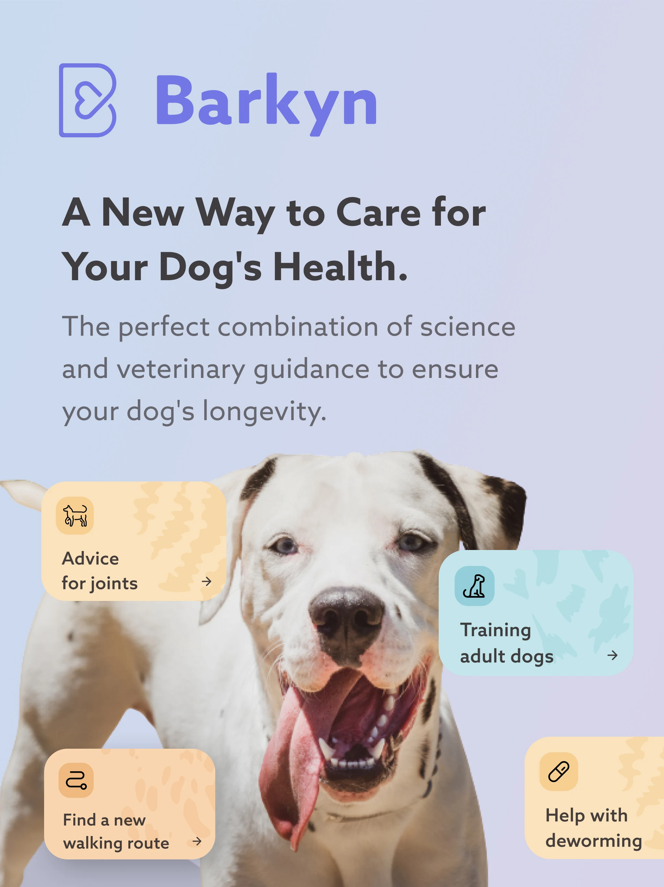
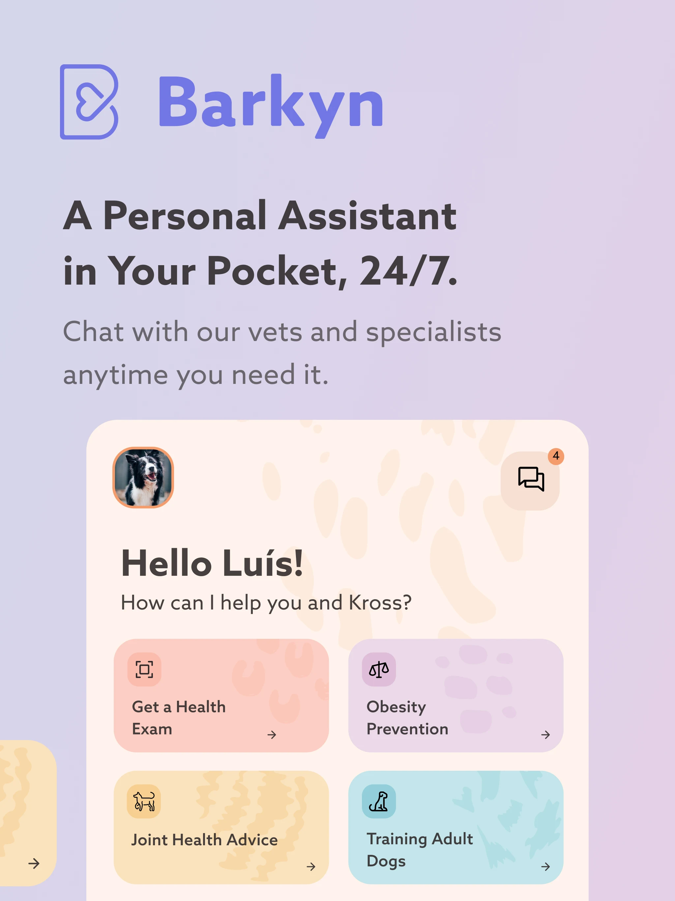
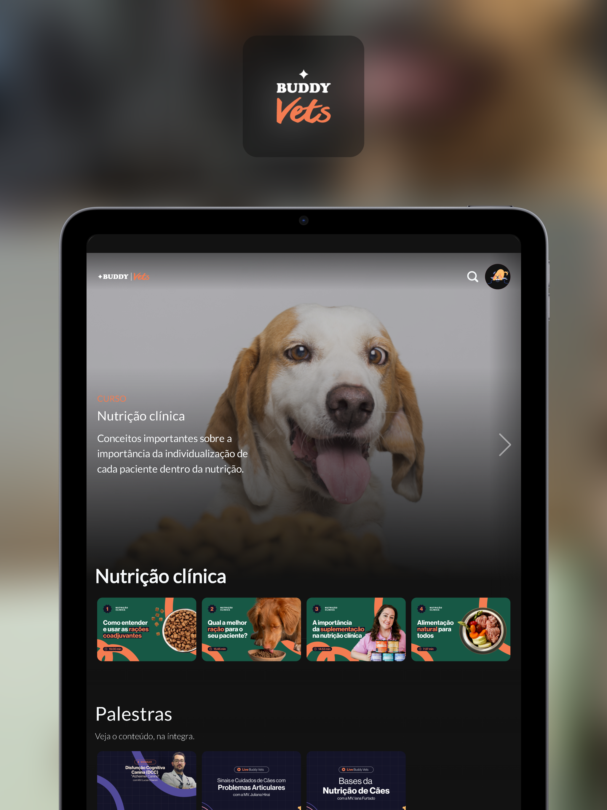
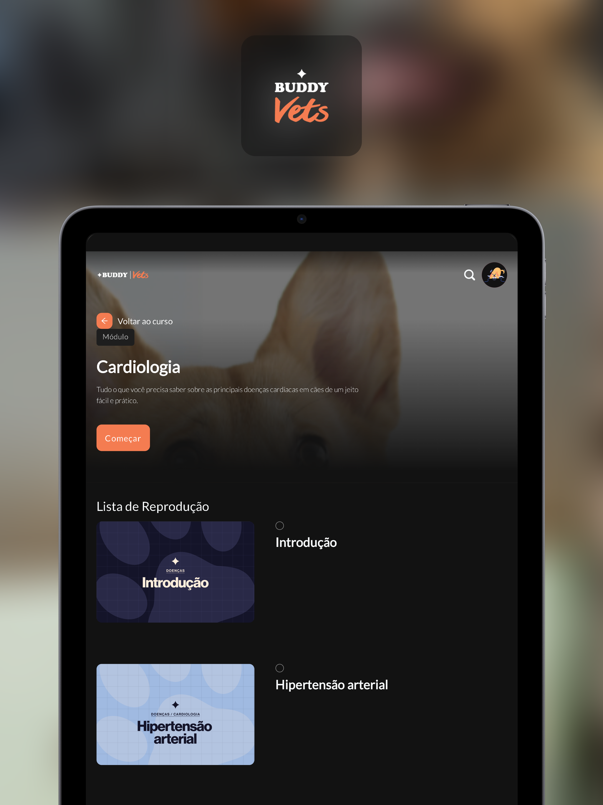
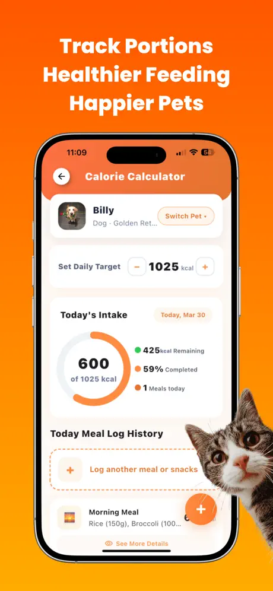
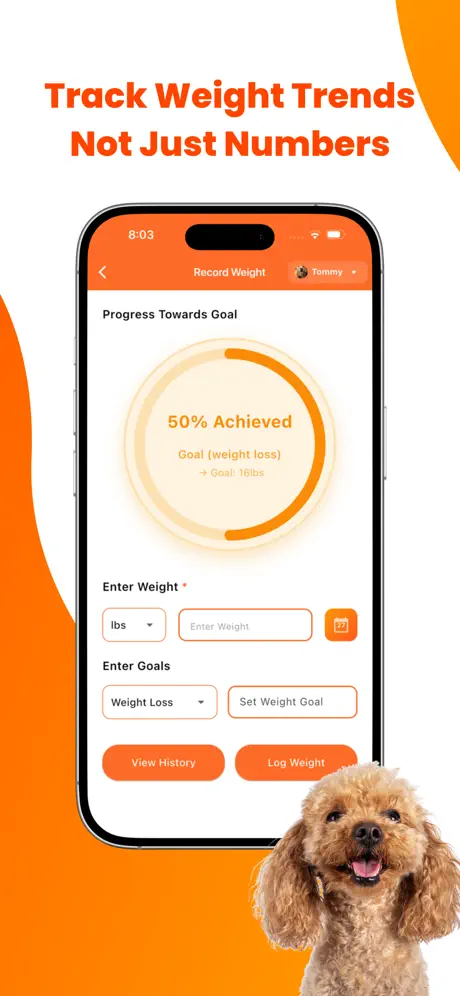
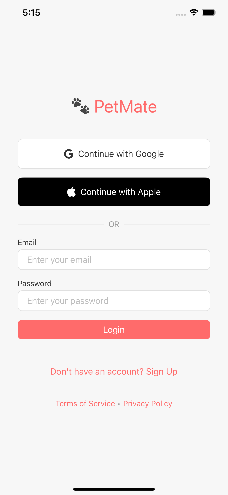
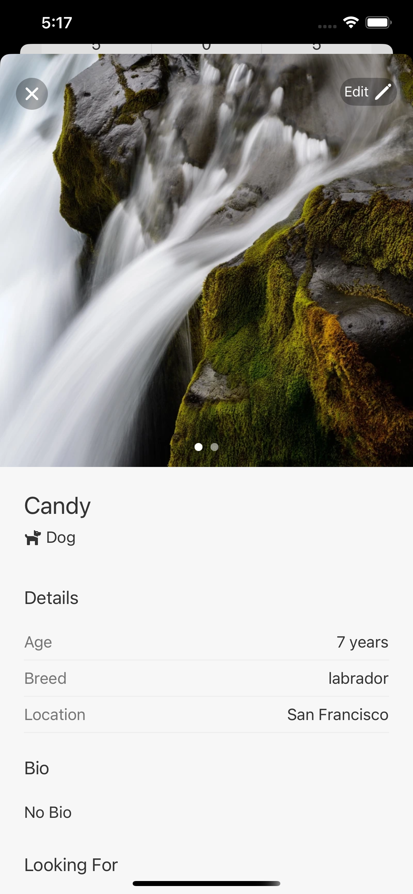
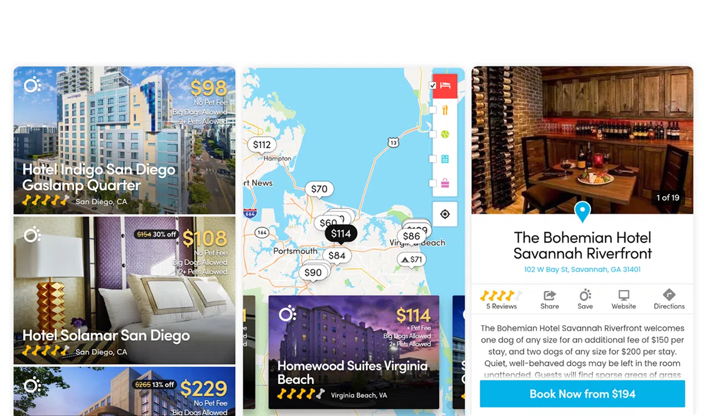

# Research – alternatives and competition – _The Doghouse_

## 1. Introduction

This document surveys the **current market** (apps, sites, and habits relevant to dog owners) to extract **actionable lessons** for the **planned first version** of _The Doghouse_ — not to shrink the product to a single feature, and not to treat the live institutional site alone as the end goal.

**Line of reference (what we are building):** institutional website (landing + blog) + members’ area in Flutter on the web as a *PWA* (*Progressive Web App* — installable in the browser), plus iOS and Android, with ideal weight calculator (free and paid), workshops (2 free + 4 paid at launch, breed organisation, one-time purchases and bundles), pet-friendly hotels map via the *Overpass API* (query layer over *OpenStreetMap*), passwordless authentication per **`RN-10`** (magic link and/or Google and/or Facebook), and commerce in **Stripe / Moloni sandbox** — see [`01_SCOPE.md`](01_SCOPE.md) and the frozen decisions in [`INTERVIEW_ANNEX.md`](INTERVIEW_ANNEX.md).

**The market is for:** inspiring implementation, copy, funnels, and requirements in [`07_REQUIREMENTS.md`](07_REQUIREMENTS.md).  
**It is not for:** comparing _The Doghouse_ “as the live site is today” as if that were the product commitment, inventing monthly subscriptions, or pulling social/community features into v1.

**Starting set:** five applications already analysed in an earlier pass (Barkyn, Buddy Vets, FLUTO, Pet Mate, BringFido), kept and refreshed against public pages. Screenshots under [`images/`](images/) from that pass are retained.  
**Last verified (public pages via fetch):** 2026-10-22.

### 1.1. Methodology

1. Fix the **planned product** (Scope + interview annex + business rules): three domains, *freemium* (useful free tier plus **paid-per-purchase** unlocks — not a single global premium membership) + one-time purchases/bundles, sandbox commerce, no v1 subscription, no in-product social.
2. Reuse the prior inventory; check for gaps against each product piece (site/blog, auth, calculator, workshops, hotels map, monetisation).
3. Examine public content (audience, offer, monetisation, trust signals).
4. Map **each piece of our ecosystem** → who in the market inspires or competes on that piece.
5. Extract numbered **lessons (L\*)** usable in requirements (priority / complexity / where they land).

**Selection criteria:** relevance to calculator, workshops, and hotels map; geographic and functional diversity (Portugal + international); public information available; room for **indirect** references when a B2B or social product still teaches structure or trust patterns.

### 1.2. Was further research needed?

**Mostly no for the core set.** The five apps already cover e-commerce/personalisation (Barkyn), professional education + calculator (Buddy Vets), multi-feature pet care + weight/map (FLUTO), trust/verification patterns (Pet Mate, indirect), and pet-friendly travel/hotels (BringFido).

| Gap vs planned Doghouse | How this document treats it |
| ----------------------- | --------------------------- |
| Public SEO / blog literacy | Barkyn’s educational articles; BringFido’s travel blog — inspire Delivery 1, not a new competitor list |
| Passwordless / social sign-in | Visible on BringFido (email code, Google/Facebook/**Apple**) — pattern note only. Doghouse auth mix stays **`RN-10`**: magic link and/or Google and/or Facebook (**not** Apple) |
| Pure PT “ideal weight” consumer calculator | No strong public peer in the prior set; Buddy Vets / FLUTO remain the closest calculator inspirations |
| Sandbox vs live payments | Market shows real checkout; Doghouse documents the **same path shape** in sandbox (`RN-19`…`RN-23`) |

No mandatory extra brands were forced into the inventory for this rewrite.

---

## 2. Map: planned Doghouse pieces ↔ market

| Piece (planned v1) | Who inspires / competes | What to learn |
| ------------------ | ----------------------- | ------------- |
| **Site + blog** | Barkyn (articles/tips); BringFido (travel blog) | Content around the product; SEO and trust; blog without in-product comments (comments stay out of v1) |
| **Auth / account** | BringFido (email code + social); Barkyn (account + app) | Low-friction sign-in shaped like BringFido, but Doghouse providers = **`RN-10`** (magic link and/or Google and/or Facebook — **Apple on BringFido is market observation only**); account history; seamless path into the members’ area |
| **Free calculator** | Buddy Vets (calorie calculator); FLUTO (weight + calories) | Simple inputs; clear output; freemium door |
| **Paid calculator** | FLUTO (weight charts / trends; CARE+ / lifetime IAP) | Richer result (percentiles, curves, recommendations) behind purchase — **lifetime access**, not a monthly SKU |
| **Workshops / video** | Buddy Vets (structured video courses) | Breed/level organisation; free intros + paid depth; B2C tone (Buddy Vets is B2B) |
| **Hotels map** | BringFido (pet-friendly hotels); FLUTO (explorer map) | Filters, place detail, open-in-maps; Doghouse uses **Overpass** hotels for signed-in members, not booking commissions |
| **Monetisation** | Barkyn (subscription + personalisation); FLUTO (IAP tiers); Buddy Vets (freemium) | Personalisation yes; freemium = **free tier + paid-per-purchase** (calculator SKU and workshop SKUs/bundles), **not** a global “premium membership” and **not** a monthly subscription |
| **Trust (indirect)** | Pet Mate (verification badges) | Useful for **account** hygiene later; **not** a v1 social network |

---

## 3. Individual analysis

### 3.1. Barkyn

- **URL:** https://www.barkyn.com  
- **Last verified:** 2026-10-22  
- **Category:** E-commerce / personalised nutrition (Portugal)

**General description:**  
Barkyn is a Portuguese company offering personalised dog food (fresh and kibble plans) with veterinary involvement. Public messaging emphasises a short dog-profile questionnaire (breed, age, weight, activity), home delivery, optional subscription, and an app with veterinary chat. Claims on the public site include 4.6★ from 6,700+ reviews and 150,000+ dogs served. One-off purchase exists but without full personalisation/vet follow-up.

**Key relevant features:** dog onboarding questionnaire; personalised plan; educational articles/tips; account and order history; Barkyn Health app.

**Strengths:** strong PT brand presence; clear personalisation funnel; content that builds trust next to commerce.

**Weaknesses vs Doghouse:** food commerce, not education/tools/maps; **monthly subscription** is central — Doghouse v1 freezes **no monthly subscription** (`RN-14`).

**Suitability:** moderate — personalisation and content marketing, not feature parity.

**Lessons (see L1, L2):** use breed/age (and related profile data) in the calculator and in breed-organised workshops; do **not** copy subscription as a v1 SKU — prefer one-time purchases and bundles.

**Screenshots:**

<table>
  <tr>
    <td></td>
    <td></td>
  </tr>
</table>

### 3.2. Buddy Vets (indirect reference)

- **URL:** https://play.google.com/store/apps/details?id=com.buddyvets.mobile  
- **Last verified:** 2026-10-22  
- **Category:** Professional education (B2B) — Android

**General description:**  
Buddy Vets is a free education platform for veterinarians, trainers, students, and animal-health professionals (Brazil). Store listing (updated 2026-10-02) highlights certified video courses, booklets, breed/disease libraries, lives/webinars, a professional community, and a **calorie calculator**.

**Key relevant features:** structured video lessons; practical calculators; freemium/professional benefits club.

**Strengths:** clear educational scaffolding; calculator as a daily tool next to courses.

**Weaknesses:** B2B tone and community gamification; no hotels map; not a consumer dog-owner product.

**Suitability:** **indirect** — workshops structure and freemium calculator pattern for B2C Doghouse.

**Lessons (see L3, L4, L5):** organise workshops by breed (or clear levels); keep a simple free calculator; free intros + paid depth without requiring a professional certification product in v1.

**Screenshots:**

<table>
  <tr>
    <td></td>
    <td></td>
  </tr>
</table>

### 3.3. FLUTO (Pet Care Tracker)

- **URL:** https://apps.apple.com/app/fluto-pet-care-tracker-dog-cat/id6744916647  
- **Last verified:** 2026-10-22  
- **Category:** All-in-one pet care — iPhone only; free with IAP

**General description:**  
FLUTO positions itself as an all-in-one pet health and care tracker (dogs and cats): weight logging and goals, calorie calculator, routines, vet diary, expenses, travel planner, **Pet Explorer map** (vets, stores, parks, pet-friendly places), AI assistant, and a pet-parent community. Store rating observed ~3.6 (small sample). Monetisation includes CARE+ monthly/yearly and a **Premium Lifetime** *IAP* (*in-app purchase*, ~$49.99) — useful as a market signal that **lifetime** access is sellable, even though Doghouse uses Stripe sandbox catalogue prices in EUR, not Apple store IAP for these SKUs (`RN-20`).

**Key relevant features:** weight trends/charts; calorie tools; explorer map; freemium + IAP.

**Strengths:** calculator and map in one consumer app; visual weight history; multiplatform ambition is absent (iOS-only) — Doghouse’s shared Flutter codebase is a differentiator.

**Weaknesses:** no workshop/video library; community and AI are outside Doghouse v1; iOS-only; reliability complaints appear in recent reviews.

**Suitability:** moderate–high for calculator + map inspiration.

**Lessons (see L6, L7):** paid calculator should feel richer than free (charts/percentiles/recommendations); hotels map should stay simple and reliable — prefer Overpass viewport + open-in-maps over a cluttered “explorer of everything” in v1.

**Screenshots:**

<table>
  <tr>
    <td></td>
    <td></td>
  </tr>
</table>

### 3.4. Pet Mate (indirect reference)

- **URL:** https://play.google.com/store/apps/details?id=com.avalontech.petmateapp  
- **Last verified:** 2026-10-22  
- **Category:** Pet dating / community — Android (India)

**General description:**  
Pet Mate is an all-in-one pet dating and community app (playdates, responsible breeding, adoption/rehoming, chat). Public copy stresses owner/pet verification, vaccination badges, location matching, and premium plans. Store listing updated 2026-10-05.

**Key relevant features:** verification and trust badges; location matching; premium visibility.

**Strengths:** explicit trust model (phone/ID/vaccination checks).

**Weaknesses:** no calculator, workshops, or hotels directory; social graph is the product.

**Suitability:** **indirect / low for MVP.** Community, likes, followers, and social profiles are **out of scope for v1** (`RN-40`). Keep only lessons that strengthen **account trust** (verified email / OAuth), not a social network roadmap.

**Lessons (see L8):** treat verification as authentication hygiene; mark social community explicitly as **future / out of scope**, not as a delivery in the first version.

**Screenshots:**

<table>
  <tr>
    <td></td>
    <td></td>
  </tr>
</table>

### 3.5. BringFido

- **URL:** https://www.bringfido.com  
- **Last verified:** 2026-10-22  
- **Category:** Pet-friendly travel / hotels — Web, iOS, Android

**General description:**  
BringFido is a long-standing dog-travel directory (since 2005) for pet-friendly hotels, rentals, restaurants, and activities, with large public catalogue claims (hundreds of thousands of places), owner reviews, blog content, and hotel booking / “Canine Concierge”. Sign-in options on the public site include email one-time code and Google / Facebook / **Apple**. Strong multiplatform presence and ratings. **Apple Sign-In here is a market observation only** — it does **not** expand Doghouse v1 auth beyond **`RN-10`** (magic link and/or Google and/or Facebook).

**Key relevant features:** hotel search and filters; place detail and policies; reviews; booking; content blog; modern auth options.

**Strengths:** best specialised reference for **pet-friendly hotels**; clear filters and trust via reviews; multiplatform.

**Weaknesses:** travel niche only — no calculator or workshops; reviews/booking are a different business model than Doghouse’s Overpass-backed map.

**Suitability:** **high** for the hotels map piece.

**Lessons (see L9, L10, L11):** prioritise clear hotel results, useful place detail, and open-in-native-maps; optional future filters inspired by policies — without promising BringFido-scale reviews or booking in v1; low-friction auth inspires Delivery 2, but the **provider mix** is Doghouse’s (`RN-10`), not BringFido’s full list.

**Screenshots:**

<table>
  <tr>
    <td></td>
  </tr>
</table>

---

## 4. Comparative tables

### 4.1. By application (features vs Doghouse)

Legend: ● = strong / present · ◐ = partial · ○ = absent / not the focus.  
Indirect rows are marked.

| Solution | Calculator | Workshops / video | Hotels / places map | Commerce | Community / social | Fit for Doghouse lessons |
| -------- | ---------- | ----------------- | ------------------- | -------- | ------------------ | ------------------------ |
| **Barkyn** | ○ | ◐ articles | ○ | ● subscription + shop | ○ | Personalisation; content — adapt away from subscription |
| **Buddy Vets** *(indirect)* | ● calories | ● pro courses | ○ | ◐ freemium / club | ● pro community | Education structure + freemium tool |
| **FLUTO** | ● weight / calories | ○ | ● explorer map | ● IAP (incl. lifetime) | ● | Calculator depth + map simplicity |
| **Pet Mate** *(indirect)* | ○ | ○ | ○ (matching, not hotels) | ● premium | ● dating/community | Trust/auth hygiene only; social **out of v1** |
| **BringFido** | ○ | ◐ blog | ● hotels | ● bookings | ◐ reviews | Hotels UX; auth patterns |
| **_The Doghouse_ (planned)** | ● free + paid | ● 2 free + 4 paid | ● Overpass hotels | ● Stripe/Moloni **sandbox** one-time | ○ v1 (`RN-40`) | Integrated B2C ecosystem |

### 4.2. By ecosystem piece (who teaches what)

| Doghouse piece | Best market teacher | Doghouse differentiator |
| -------------- | ------------------- | ----------------------- |
| Blog / SEO | Barkyn, BringFido | Articles without comment threads in v1 |
| Calculator | Buddy Vets, FLUTO | Breed + age → free approx / paid richer result |
| Workshops | Buddy Vets | Short B2C catalogue; breed bundles; lifetime access to purchased SKUs |
| Hotels map | BringFido, FLUTO | Overpass viewport; signed-in free map; no booking commission product |
| Checkout | Barkyn, FLUTO | Same catalogue on Web + native via Stripe sandbox; no store IAP for these SKUs |
| Auth | BringFido (pattern) | Doghouse mix = **`RN-10`**: magic link and/or Google and/or Facebook — **not** Apple (Apple on BringFido = market only); seamless **site → Flutter Web** when already signed in |

---

## 5. Differentiation of _The Doghouse_ (planned v1)

Aligned with Scope, annex, and business rules:

1. **One consumer ecosystem** — site/blog + calculator + workshops + hotels map + account in one project (market is fragmented by niche).
2. **One-time purchases and bundles** — lifetime access to what was paid; **no monthly subscription** in v1.
3. **Sandbox commerce as a teaching product** — sell path works as if real; no real-money charges operated in this public project.
4. **Multiplatform from one Flutter codebase** — Web PWA, iOS, Android (vs FLUTO iOS-only, Buddy Vets Android-focused).
5. **Explicit non-goals in v1** — article comments, in-product social network, live chat, store IAP for catalogue SKUs.

**Where the market still wins today:** depth of hotel inventory and reviews (BringFido); food logistics and brand scale (Barkyn); all-in-one care journaling (FLUTO). Doghouse does not need to beat those niches feature-for-feature; it needs a coherent skeleton and a walkable sandbox product.

---

## 6. Lessons for the planned first version

| # | Lesson | Priority | Complexity | Where it lands |
| - | ------ | -------- | ---------- | -------------- |
| L1 | Use dog profile fields already in scope (breed, age, …) to drive calculator inputs/results and breed-organised workshops — without inventing a separate recommendation engine | High | Medium | Deliveries 3, 5, 6 |
| L2 | Do **not** ship monthly subscription in v1; keep one-time SKUs + bundles (`RN-14`…`RN-16`) | High | Low | Delivery 6 / rules |
| L3 | Structure workshops clearly (by breed); free intros + paid depth | High | Medium | Deliveries 5–6 |
| L4 | Keep a simple, credible **free** calculator as the door | High | Medium | Delivery 3 |
| L5 | Freemium as **free tier + paid-per-purchase** (not a global premium pass, not monthly): free tools/content usable when signed in; paid unlocks are per SKU/bundle | High | Medium | Deliveries 3, 5, 6 |
| L6 | Paid calculator should add visual richness (e.g. percentiles / curves / recommendations), inspired by weight charts | High | Medium | Delivery 6 |
| L7 | Hotels map: reliable list/map + detail + open-in-maps; avoid overloading v1 with every POI category | High | Medium | Delivery 4 |
| L8 | Verification → authentication hygiene only; social community = **future / out of scope** | Medium | Low | Delivery 2; `RN-40` |
| L9 | Hotel search UX: clear results and useful place fields (name, location, pet-related tags when available) | High | Medium | Delivery 4 |
| L10 | Do not require user reviews or booking in v1 (BringFido-scale) | Medium | Low | Delivery 4 scope guard |
| L11 | Low-friction auth inspired by travel apps (email code / social), but Doghouse providers stay **`RN-10`**: magic link and/or Google and/or Facebook — **do not** import BringFido’s Apple Sign-In into v1 | High | Medium | Delivery 2 / `RN-10` |
| L12 | Institutional **blog** next to tools improves trust and SEO — keep static articles, no comment product in v1 | High | Low | Delivery 1 |
| L13 | Prefer **lifetime** entitlement language for paid items (market signal from FLUTO lifetime IAP; Doghouse EUR catalogue + Stripe sandbox) | High | Low | Delivery 6 / copy |

---

## 7. Conclusion

Nobody in the examined set offers, in one B2C package, what Scope defines: literacy (site + blog) + ideal weight calculator (free + paid) + breed workshops (free + paid, one-time) + pet-friendly hotels map + account/payments in a **public sandbox simulation**.

Excellence is **per piece**: personalisation and content (Barkyn), educational structure (Buddy Vets), weight tools and explorer maps (FLUTO), trust patterns (Pet Mate, indirect), hotels directory (BringFido). This research copies what each does well on its piece and keeps Doghouse’s freezes (no v1 subscription, no social network, Overpass hotels, sandbox Stripe/Moloni).

**Status:** research **aligned** (L1–L13; auth mix safeguarded to `RN-10`). The lessons above are written so [`07_REQUIREMENTS.md`](07_REQUIREMENTS.md) can turn them into numbered functional and non-functional requirements without reopening the market survey — when that design step is opened.

---

## 8. References (URLs verified 2026-10-22)

1. https://www.barkyn.com  
2. https://play.google.com/store/apps/details?id=com.buddyvets.mobile  
3. https://apps.apple.com/app/fluto-pet-care-tracker-dog-cat/id6744916647  
4. https://play.google.com/store/apps/details?id=com.avalontech.petmateapp  
5. https://www.bringfido.com  
6. [`01_SCOPE.md`](01_SCOPE.md) — planned ecosystem  
7. [`INTERVIEW_ANNEX.md`](INTERVIEW_ANNEX.md) — frozen product decisions  
8. [`03_BUSINESS_RULES.md`](03_BUSINESS_RULES.md) — `RN-14`…`RN-25`, `RN-33`…`RN-36`, `RN-40`
