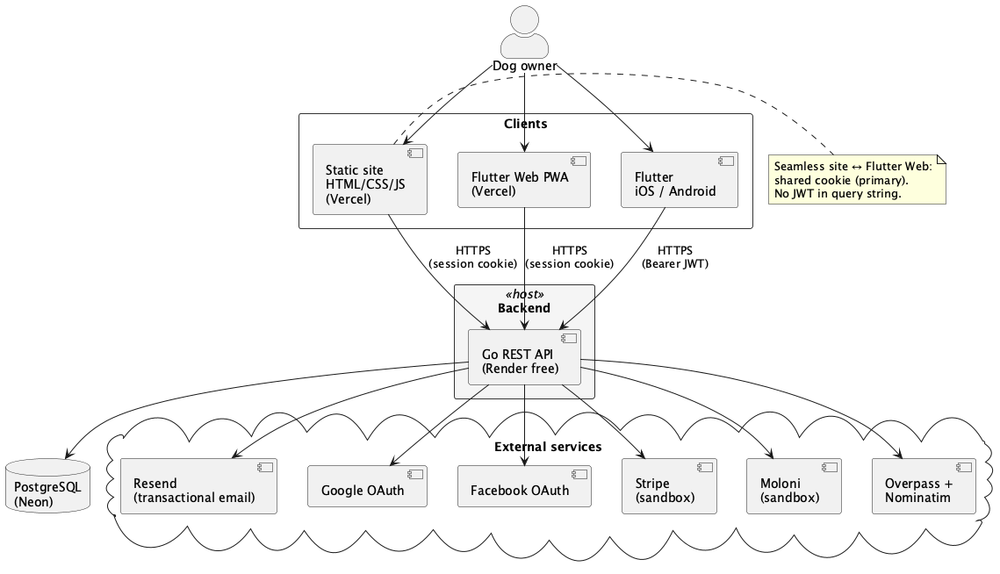

# Architecture – _The Doghouse_

## 1. Introduction

This document describes the **architecture of the planned first version** of _The Doghouse_: components, hosting, authentication/session, seamless site↔Flutter Web, payments, and the closed decisions that [`07_REQUIREMENTS.md`](07_REQUIREMENTS.md) left for here (especially session transport and seamless mechanism — **RF-16**, **RF-20**).

**Sources:** [`01_SCOPE.md`](01_SCOPE.md), [`02_PERSONAS_AND_FLOWS.md`](02_PERSONAS_AND_FLOWS.md), [`03_BUSINESS_RULES.md`](03_BUSINESS_RULES.md), [`07_REQUIREMENTS.md`](07_REQUIREMENTS.md).

**Principles:**

- Stack already fixed in Scope — do not reinvent.
- Prefer **€0** free tiers while sustainable (API cold start accepted).
- Solo operation — keep deploy and secrets simple.
- Schema detail → [`09_DATABASE.md`](09_DATABASE.md); HTTP contracts → [`10_API_ENDPOINTS.md`](10_API_ENDPOINTS.md); UML sequences → [`11_UML_DIAGRAMS.md`](11_UML_DIAGRAMS.md).

---

## 2. Closed decisions (this revision)

| # | Topic | Decision |
| - | ----- | -------- |
| **D1** | Session | Single **JWT**, validity **7 days**, renewable on re-authentication — closes **RF-16** / **RN-12** (no access+refresh split in v1) |
| **D2** | Session transport | **Web** (static site + Flutter Web): session cookie `HttpOnly` + `Secure` (+ `SameSite=Lax` unless a documented exception is needed). **Native iOS/Android:** `Authorization: Bearer` only — closes transport left open in **RF-16** |
| **D3** | Seamless site → Flutter Web | **Primary:** shared cookie on the **Vercel** host (same project / shareable parent domain). **Validate** cookie sharing on the real Vercel layout (including `*.vercel.app`); if the parent-domain cookie cannot be set or sent, **activate the fallback**. **Do not** put the JWT in the query string. **Fallback:** short-lived **one-time code** (single use) exchanged at the API for a session — not the normal path |
| **D4** | Auth at Delivery 2 go-live | **Magic link** and **Google** and **Facebook** OAuth available together (**RN-10** / **RF-11**); no email+password; no Apple Sign-In (**RF-12**, **RF-13**) |
| **D5** | API hosting | **Render** Web Service on the **free** plan, Docker image |
| **D6** | Cold start UX | Accepted. If the API gives **no HTTP response within 3 seconds** on the login flow → show a user-facing notice (“the server may be waking up…”). Keep waiting; recoverable timeout about **60–90 s** — not a fake “wrong credentials” failure |
| **D7** | Keep-alive ping | **Out** of plan A (no artificial keep-alive to dodge free-tier idle) |
| **D8** | Static site + Flutter Web | **Vercel** — institutional site already live at `https://the-doghouse-iota.vercel.app/`; Flutter Web on the **same** Vercel hosting for seamless cookies |
| **D9** | Database | **PostgreSQL on Neon** (free tier) |
| **D10** | Payments / invoicing | **Stripe sandbox** + **Moloni sandbox** in this public project; same catalogue on Web and native; **no** store IAP for these SKUs (**RN-19…RN-21**, **RF-56…RF-57**) |
| **D11** | Transactional email | **Resend** for magic links and optional welcome / purchase confirmation mail (**RF-15**, **RF-19**, **RF-70**) |
| **D12** | Error tracking | **Sentry** = **Optional** (not required; product analytics stay out per **RN-42** / **RF-75**) |
| **D13** | API authority | Frontend = UX; **backend revalidates** session, SKUs, entitlements, discounts (**RNF-13**) |
| **D14** | Plan B (API host) | If Render free stops serving the product: evaluate another free/cheap container host — **without** changing plan A while free works |

---

## 3. Context diagram

**PlantUML source:** [`diagrams/plantuml/08_context.puml`](diagrams/plantuml/08_context.puml)

_Figure 1 – Context of the planned first version: dog owner, static site and Flutter Web (Vercel), native apps, Go API (Render), Neon, Resend, Google/Facebook, Stripe sandbox, Moloni sandbox, Overpass/Nominatim._

*(Legacy asset [`images/architecture_diagram.png`](images/architecture_diagram.png) is superseded by Figure 1 for this revision.)*

---

## 4. Components

### 4.1. Institutional site (Vercel)

- Static **HTML / CSS / JS** — landing + blog; SEO-friendly; English UI (**RF-01…RF-09**).
- CTAs into sign-in / members’ area.
- **No** payment secrets or privileged business logic in the browser.
- Publishes the site folder only — not documentation markdown.

### 4.2. Flutter members’ area (Web PWA + iOS + Android)

- Calculator (free + paid), workshops, hotels map, profile, purchases, invoices (**RF-25…RF-51**, **RF-69**).
- **Web:** uses the shared session cookie (**D2**, **D3**).
- **Native:** authenticates **inside the app** with Bearer JWT; does **not** inherit the static-site cookie path (**RF-22** / **RN-13**).
- One shared codebase (**RF-71**); store publication path in Delivery 7 (**RF-72**).
- Map client uses geolocation (`geolocator`) after consent and opens native maps (**RF-44**, **RF-49**); concrete map widget wiring is an implementation detail under this architecture.

### 4.3. Go REST API (Render free)

- Auth, session, catalogue content, entitlements, Stripe checkout + webhooks, Moloni simulation, Overpass proxy/cache, Nominatim geocode, transactional email triggers.
- Layered internally: routes → handlers → services → data access (**RNF-14**).
- **Cold start** after idle on free tier is expected; UX per **D6**.
- Docker for reproducible builds on Render; prefer an **EU** region when available on free.
- Tests: `go test` for critical logic (**RNF-09**); e2e covered with delivery Done (**RNF-10**).

### 4.4. PostgreSQL (Neon)

- Users, sessions/tokens as needed, catalogue metadata, purchases, entitlements, invoice references, Overpass cache (TTL 24 h — **RF-47**), promo codes/campaigns when used.
- Full schema in [`09_DATABASE.md`](09_DATABASE.md).

### 4.5. External services

| Service | Role |
| ------- | ---- |
| **Resend** | Magic link; optional welcome / purchase confirmation (**D11**, **RF-15**, **RF-19**, **RF-70**) |
| Google + Facebook OAuth | Social login from Delivery 2 go-live (**D4**) |
| Stripe **sandbox** | Checkout + webhooks (**RF-56…RF-68**) |
| Moloni **sandbox** | Simulated PDF invoice when paid amount > 0 (**RF-60**, **RF-61**) |
| Overpass API | Pet-friendly hotels by viewport (**RF-45…RF-47**) |
| Nominatim | Text geocoding (**RF-44**) |
| Sentry (optional) | Error tracking only if enabled (**D12**) |

---

## 5. Authentication and session

### 5.1. Methods (Delivery 2)

All of the following are in scope for auth go-live:

1. **Magic link** — email → link → single use; **15 minutes** (**RN-11** / **RF-14**).
2. **Google** OAuth — validated at the API.
3. **Facebook** OAuth — validated at the API.

**Forbidden:** email + password; Apple Sign-In (**RF-12**, **RF-13**).

### 5.2. Token model (closes RF-16)

| Item | Value |
| ---- | ----- |
| Token | Single **JWT** |
| Validity | **7 days** |
| Renewal | On re-authentication |
| Web transport | `HttpOnly` + `Secure` cookie (**D2**) |
| Native transport | `Authorization: Bearer <jwt>` (**D2**) |

Claims stay minimal (subject, expiry, issued-at). Exact cookie name and path are implementation detail; behaviour above is normative for v1.

### 5.3. Cold start notice (login)

Aligned with **D6**:

1. Client starts an API call (magic-link request, OAuth completion, or first authenticated hit of the login path).
2. If **no HTTP response within 3 seconds** → show a clear notice that the server may be starting after idle; ask the user to wait.
3. Do **not** cancel the in-flight operation only because the notice appeared.
4. If still unsuccessful after about **60–90 seconds** → recoverable error (“try again”), not a credentials failure.

### 5.4. Seamless site ↔ Flutter Web (closes RF-20 / RF-21)

**Goal:** signed-in on the static site → open members’ area on Flutter Web **without** signing in again.

**Primary (D3):**

1. Host static site and Flutter Web on **Vercel** under a shareable parent domain.
2. After auth, set the session cookie for that parent domain (`Secure`, `HttpOnly`, `SameSite=Lax` unless a documented exception is required).
3. Flutter Web sends that cookie on API calls (CORS and cookie settings must allow the Vercel origins used).
4. **Validate in the real Vercel deploy** (preview and production URLs). Free `*.vercel.app` hostnames sometimes block useful parent-domain cookies — if sharing fails in practice, use the fallback below rather than inventing `localStorage` or query-string JWTs.

**Fallback (D3):** if shared cookies cannot be configured on free hosting, use a **one-time code** (short TTL, single use) in the handoff URL; the Flutter Web app exchanges it at the API for a session. **Never** put a long-lived JWT in the query string.

**Native apps:** always authenticate inside the app (**RF-22**).

---

## 6. Payments and invoicing (sandbox)

Aligned with Personas §3.4 / §3.9 and **RF-52…RF-70**:

1. Signed-in user starts checkout — refused if they already own the same SKU; bundles/partial ownership per **RF-64** / **RF-65**.
2. API resolves discounts (**RF-66**); amount **0.00 EUR** → paid order + entitlements **without** Stripe/Moloni (**RF-67**).
3. Amount > 0 → **Stripe Checkout** (sandbox).
4. Stripe webhook → API (**idempotent**, **retriable** — **RF-62**, **RNF-12**).
5. Unlock purchased entitlements; **Moloni sandbox** simulation when amount > 0, with retry; access stays if Moloni fails (**RF-60**, **RF-63**).
6. Client may **poll** purchase status if the webhook is delayed (**RF-62**).
7. Profile lists simulated invoices (**RF-69**).

Live Stripe/Moloni remain a **reuse** option via environment variables — not operated as real money in this public project (**RN-19**, **RN-21**).

---

## 7. Hotels map (architecture note)

- Available to **signed-in** members only (**RF-43**).
- Backend queries **Overpass** for the current **viewport**, caches **24 h**, geocodes text via **Nominatim** (**RF-44…RF-47**).
- Client: Near me after consent; open in native maps (**RF-44**, **RF-49**).
- No reviews/booking product (**RF-51**). Endpoint shapes → [`10_API_ENDPOINTS.md`](10_API_ENDPOINTS.md).

---

## 8. Deploy, environments, and secrets

| Environment | Site / Flutter Web | API | Database | Notes |
| ----------- | ------------------ | --- | -------- | ----- |
| Local | static files / Flutter web | Go local (Docker Compose) | Neon branch or local Postgres | Secrets in `.env` (gitignored) |
| Public demo | **Vercel** | **Render** free | **Neon** | HTTPS; free-tier cold starts |

**Secrets (never in Git):** JWT signing key, Google/Facebook OAuth secrets, Stripe sandbox keys, Moloni sandbox credentials, **Resend API key**, Neon connection string (**RF-73**, **RNF-07**, **D11**).

**Observability:** API logs without sensitive data in clear text; correlate Stripe webhooks by event id (**RNF-12**). Sentry only if **D12** is enabled.

**Docker:** Compose for local API (+ optional local Postgres); production API image on Render (**D5**).

---

## 9. What this document does not close

| Topic | Document |
| ----- | -------- |
| Tables, indexes, migrations | [`09_DATABASE.md`](09_DATABASE.md) |
| Endpoint list, payloads, errors | [`10_API_ENDPOINTS.md`](10_API_ENDPOINTS.md) |
| Class / sequence UML | [`11_UML_DIAGRAMS.md`](11_UML_DIAGRAMS.md) |
| Effort hours | [`04_WBS.md`](04_WBS.md) |

---

## 10. Traceability (decisions → requirements)

| Decision / piece | RF / RNF / RN |
| ---------------- | ------------- |
| JWT 7 days | RF-16, RN-12 |
| Cookie Web / Bearer native | RF-16, RF-22, D2 |
| Seamless + fallback code | RF-20, RF-21, D3 |
| Magic link + Google + Facebook | RF-11…RF-15, RN-10, D4 |
| Cold start UX 3 s | D6 (supports usable login on free tier) |
| Vercel + Render + Neon | RF-71, RNF-01, D5, D8, D9 |
| Resend transactional email | D11, RF-15, RF-19, RF-70 |
| Stripe / Moloni sandbox | RF-56…RF-68, RNF-12, RNF-15 |
| Overpass / Nominatim | RF-43…RF-49 |
| API authority | RNF-13, D13 |
| Optional Sentry | D12, RF-75 |

---

## 11. Conclusion

The planned first version runs on **Vercel** (static site + Flutter Web) + **Flutter** native + **Go on Render free** + **Neon** + **Resend**, with **magic link + Google + Facebook**, a **7-day JWT**, **cookie-based seamless Web** (one-time code only as fallback), and **sandbox** Stripe/Moloni. Cold starts are accepted with an honest **3-second** user notice so operators are not blamed for free-tier wake-up.

**Status:** architecture **aligned** (D1–D14; **D11** = Resend). Context diagram source + PNG under `diagrams/`. Database, API, and UML documents (`09`–`11`) are aligned; glossary updated with this hosting/email freeze.

**Next (when ordered):** rewrite [`09_DATABASE.md`](09_DATABASE.md).
