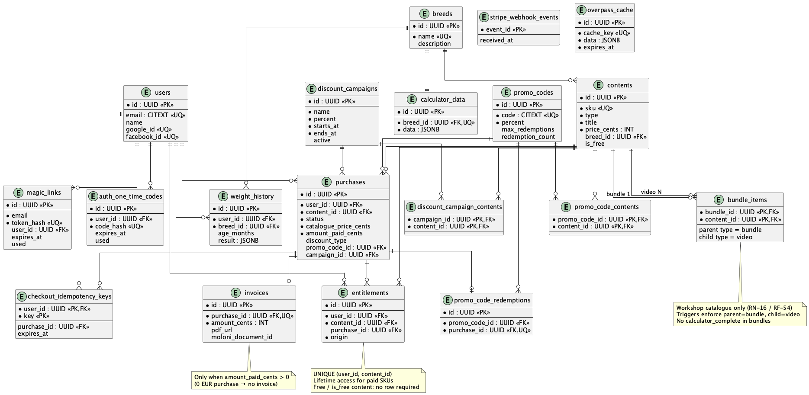

# Database – _The Doghouse_

## 1. Introduction

This document defines the **PostgreSQL** data model for the planned first version of _The Doghouse_ (**Neon**, architecture **D9**). It closes schema-level choices left open by [`07_REQUIREMENTS.md`](07_REQUIREMENTS.md) and [`08_ARCHITECTURE.md`](08_ARCHITECTURE.md): money as **integer cents**, session JWT **not** stored in the database, lifetime access via **`entitlements`**, and promo/campaign tables operated by script (no admin UI — **RN-26**).

**Sources:** [`03_BUSINESS_RULES.md`](03_BUSINESS_RULES.md), [`07_REQUIREMENTS.md`](07_REQUIREMENTS.md), [`08_ARCHITECTURE.md`](08_ARCHITECTURE.md).

**Normative DDL:** [`sql/09_schema.sql`](sql/09_schema.sql)  
**Ops examples (campaigns / codes):** [`sql/09_ops_examples.sql`](sql/09_ops_examples.sql)  
**ER diagram (PlantUML):** [`diagrams/plantuml/09_er.puml`](diagrams/plantuml/09_er.puml)

**Principles:**

- UUID primary keys; `TIMESTAMPTZ` for all timestamps; money in **INTEGER cents** (EUR).
- Catalogue prices and paid amounts never use floating point in the database.
- Access to **paid** SKUs = row in `entitlements` (not a global `is_premium` flag) — **RN-14**, **RN-24**, **RF-64**.
- **Free** catalogue rows (`is_free` and/or `price_cents = 0` intros) do **not** require an `entitlements` row; any signed-in member may use them per product rules (**RN-09**, **RN-29**, **RN-31**).
- Calculator and workshops stay **independent catalogues** — workshop bundles contain **videos only** (**RN-16**, **RF-54**).
- Seed / catalogue rows are loaded in implementation deliveries — **not** in this DDL file.
- HTTP contracts → [`10_API_ENDPOINTS.md`](10_API_ENDPOINTS.md); sequences → [`11_UML_DIAGRAMS.md`](11_UML_DIAGRAMS.md).

---

## 2. Closed decisions (this revision)

| # | Topic | Decision |
| - | ----- | -------- |
| **DB-1** | Money | Store catalogue price, discount-derived paid amount, and invoice amount as **INTEGER cents**; currency default `EUR` |
| **DB-2** | Session | **No** JWT / refresh-token table — cookie (Web) / Bearer (native) only (**D1**, **D2**) |
| **DB-3** | Seamless fallback | Persist short-lived **one-time codes** (`auth_one_time_codes`) hashed; never put JWT in the query string (**D3**) |
| **DB-4** | Access | Table **`entitlements`** with `UNIQUE (user_id, content_id)` for **paid** lifetime unlocks; origins `purchase` / `bundle` / `grant`. Free SKUs need **no** entitlement row |
| **DB-5** | 0.00 EUR checkout | Completed purchase + entitlements **without** Stripe ids and **without** `invoices` row (**RN-27**, **RF-67**) |
| **DB-6** | Commercial snapshot | On each purchase: `catalogue_price_cents`, `discount_type`, `discount_percent`, optional `promo_code_id` / `campaign_id`, `amount_paid_cents` (**RN-28**, **RF-68**); CHECK keeps snapshot columns consistent with `discount_type` |
| **DB-7** | Promos | `promo_codes` + `discount_campaigns` with per-SKU link tables; non-stacking resolved in the API (**RN-26**, **RF-66**) |
| **DB-8** | Stripe | `stripe_webhook_events.event_id` PK for idempotency; `checkout_idempotency_keys` for client retry safety (**RF-62**, **RNF-12**) |
| **DB-9** | Maps cache | `overpass_cache` with `expires_at` (TTL **24 h** application policy — **RF-47**) |
| **DB-10** | Weight history | Optional `weight_history` in schema; product UI may omit persistence in v1 |
| **DB-11** | Workshop bundles | `bundle_items`: parent `contents.type = bundle`, child `contents.type = video` only; enforced by triggers. **No** `calculator_complete` (or other) children — independent catalogues (**RN-16**, **RF-54**) |

---

## 3. Entity–relationship diagram

_Figure 1 – Relational model of the planned first version. Layout convention: the “one” side of each relationship sits above the “many” side._

*(Legacy asset [`images/erd.png`](images/erd.png) is superseded by Figure 1 for this revision.)*

---

## 4. Conventions

| Concern | Convention |
| ------- | ---------- |
| Identifiers | `UUID`, default `gen_random_uuid()` (`pgcrypto`) |
| Email / promo codes | `CITEXT` (case-insensitive uniqueness) |
| Money | `INTEGER` cents ≥ 0 (`invoices.amount_cents` > 0) |
| Time | `TIMESTAMPTZ`; application sets magic-link and OTC TTLs |
| Secrets | Store **hashes** of magic-link tokens and one-time codes — never plaintext |
| Enums | PostgreSQL `ENUM` types listed in the schema file |
| Cross-row type rules | Triggers on `bundle_items` / `contents` (see DDL) — not expressible as table-local `CHECK` |

---

## 5. Domains

### 5.1. Users and authentication

#### `users`

One row per registered dog owner. Social providers attach via unique nullable `google_id` / `facebook_id` (**RN-10**, **D4**). There is **no** password column and **no** admin role table in v1.

| Column | Notes |
| ------ | ----- |
| `email` | Required, unique (`CITEXT`) |
| `name` | Optional display name |
| `registered_at` / `last_access` | Audit / UX |

#### `magic_links`

Records each magic-link request. Rate limit **5 / hour / email** is enforced by counting recent rows (**RNF** auth limits in requirements). `token_hash` is unique; `user_id` may be null until the email is known as a user.

#### `auth_one_time_codes`

Seamless **fallback** only (**D3**): short-lived, single-use code exchanged at the API for a session. Primary path remains the shared session cookie.

### 5.2. Catalogue

#### `breeds`

Breed catalogue for calculator data and workshop videos.

#### `calculator_data`

One JSONB payload per breed (`breed_id` unique). Free vs complete response is an **API** decision (**RN-29**, **RN-30**), not a second table. The sellable complete-calculator SKU is a separate `contents` row (`type = calculator_complete`), not a bundle member.

#### `contents`

Sellable / free SKUs: `video`, `bundle`, `calculator_complete`.

| Constraint | Rule |
| ---------- | ---- |
| Videos | `breed_id` **required** |
| Complete calculator | `breed_id` **null** (global SKU); sold alone — **not** placed in `bundle_items` |
| Bundles | Workshop packages only (`breed` bundle / complete present); composition in `bundle_items` |
| Price | `price_cents`; free intros use `0` and/or `is_free` |

#### `bundle_items`

Workshop-catalogue composition only (**DB-11**, **RN-16**, **RF-54**):

| Side | Required `contents.type` |
| ---- | ------------------------ |
| `bundle_id` (parent) | `bundle` |
| `content_id` (child) | `video` |

Cross-catalogue packages (calculator plus workshops in one SKU) are **out of scope** for v1. DDL triggers reject invalid parent/child types and block type changes that would break existing links. Partial ownership rules (**RN-25**, **RF-65**) use this graph plus `entitlements` over **video** children only.

### 5.3. Commerce

#### `purchases`

Checkout attempt / completed order. Status: `pending` | `completed` | `failed`. Stripe session / payment-intent ids are unique when present. Discount snapshot fields implement **RN-28**; a table `CHECK` ties `discount_type` to the optional promo/campaign FKs and forces `discount_percent = 0` when type is `none`.

#### `entitlements`

Lifetime access to a **paid** content SKU for a user. Bundle purchase may insert multiple rows (`origin = 'bundle'`) for **missing video** items only. `grant` allows ops-side access without a purchase.

**Free content:** SKUs marked free (`is_free` and/or free intros at `0` cents) are available to signed-in members **without** an `entitlements` row. The API must not require a purchase trail for those items.

Access checks for **paid** media **must** read this table (or an equivalent derived query), not only `purchases.status`.

#### `invoices`

At most one invoice per purchase; `amount_cents > 0`. Created only when Moloni simulation runs (**RN-21**, **RN-27**). Moloni failure must not delete entitlements (**RN-23**, **RF-63**).

### 5.4. Promotions

| Table | Role |
| ----- | ---- |
| `discount_campaigns` | Time window + percent; `active` flag |
| `discount_campaign_contents` | SKUs the campaign applies to (any catalogue SKU: video, bundle, or calculator) |
| `promo_codes` | Code string, window, optional `max_redemptions`, `redemption_count` |
| `promo_code_contents` | SKUs the code applies to |
| `promo_code_redemptions` | One redemption row per purchase using a code |

Non-stacking (higher percent wins; tie → code) is **application** logic (**RN-26**). Concurrent redemption should `SELECT … FOR UPDATE` the promo row (see ops examples). Promos may target the calculator SKU; that is **not** the same as putting the calculator inside a workshop bundle.

### 5.5. Idempotency and cache

| Table | Role |
| ----- | ---- |
| `stripe_webhook_events` | PK = Stripe `event_id` — ignore duplicates |
| `checkout_idempotency_keys` | `(user_id, key)` → cached checkout response / purchase |
| `overpass_cache` | Viewport/query key → JSON hotels; purge/refresh by `expires_at` |

### 5.6. Optional history

#### `weight_history`

Optional calculator runs (`age_months` + JSON `result`). Included so Delivery code can persist history without a migration; v1 UI may leave it unused (**DB-10**).

---

## 6. Integrity rules (cross-table)

1. **Unlock only on success:** entitlements for paid SKUs are written when the purchase becomes `completed` (Stripe webhook or 0 EUR path) — **RN-22**, **RN-23**.
2. **No duplicate SKU access row:** `UNIQUE (user_id, content_id)` on `entitlements` — supports **RN-24**.
3. **Free SKUs:** no entitlement required; do not invent purchase rows solely to “unlock” free intros.
4. **0 EUR paid path:** `amount_paid_cents = 0` after a real checkout resolution (e.g. 100% code) → entitlements yes, Stripe/Moloni/invoice no — **RN-27**.
5. **Invoice amount:** must match paid amount when issued; always > 0.
6. **Promo FKs on purchases:** required exactly when `discount_type` is `code` or `auto_campaign` (table `CHECK`).
7. **Webhook retries:** insert into `stripe_webhook_events` first (or equivalent unique constraint) before side effects — **RF-62**.
8. **Bundle composition:** only workshop videos under a bundle parent — **DB-11**.

---

## 7. Indexes and enforcement (summary)

Beyond primary/unique keys, the schema defines supporting indexes for:

- magic links by email + time (rate limit);
- purchases by user / status;
- entitlements by user;
- Overpass cache expiry;
- weight history by user + time.

Triggers:

- `bundle_items_types_trg` — parent `bundle`, child `video`;
- `contents_bundle_role_trg` — block type changes that break existing bundle links.

Full definitions: [`sql/09_schema.sql`](sql/09_schema.sql).

---

## 8. Out of scope for this schema

- Admin / CMS tables (content placement is ops / seed — **RN** scope).
- Refresh-token or server-side session store.
- Apple / Google IAP receipt tables (**RN-20**).
- Affiliate / multi-currency commerce.
- Analytics event warehouse (**RN-42**).
- Cross-catalogue SKUs (calculator + workshops in one package) — **RN-16**, **RF-54**.

---

## 9. Traceability

| Concern | Rules / requirements | Schema |
| ------- | -------------------- | ------ |
| Passwordless + social | RN-10, RF-11…RF-15, D4 | `users`, `magic_links` |
| Session not in DB | D1, D2 | (none) |
| Seamless fallback | D3, RF-20, RF-21 | `auth_one_time_codes` |
| Lifetime per paid SKU | RN-14, RN-24, RF-41, RF-64 | `entitlements` |
| Free content without entitlement | RN-09, RN-29, RN-31 | `contents.is_free` / `price_cents`; no entitlement row |
| Independent catalogues / workshop bundles | RN-16, RF-54, RF-38 | `bundle_items` + type triggers (**DB-11**) |
| Bundles / partial ownership | RN-25, RF-65 | `bundle_items`, `entitlements` (videos) |
| Stripe + Moloni sandbox | RN-20…RN-23, D10 | `purchases`, `invoices`, webhook tables |
| Promos / campaigns | RN-26…RN-28, RF-66…RF-68 | promo / campaign tables + purchase snapshot `CHECK` |
| 0 EUR path | RN-27, RF-67 | purchases without invoice |
| Overpass TTL | RN-36, RF-47 | `overpass_cache` |
| Neon / Postgres | D9 | this document + DDL |

---

## 10. Status

Database modeling for the planned first version is **aligned**: DDL + ops examples under `sql/`, ER source + PNG under `diagrams/`, decisions **DB-1…DB-11**.
