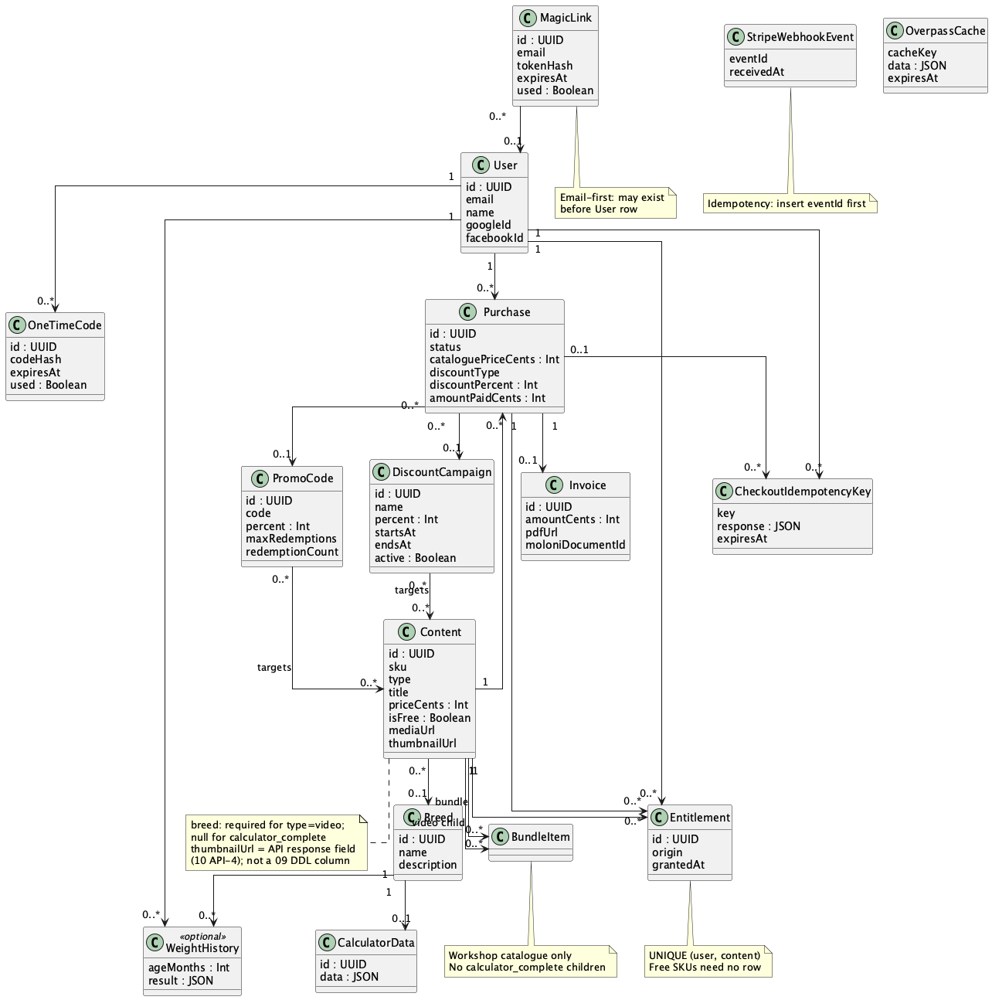
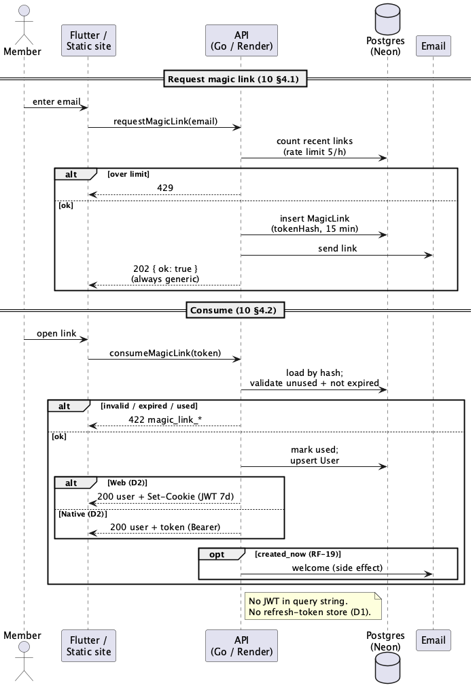
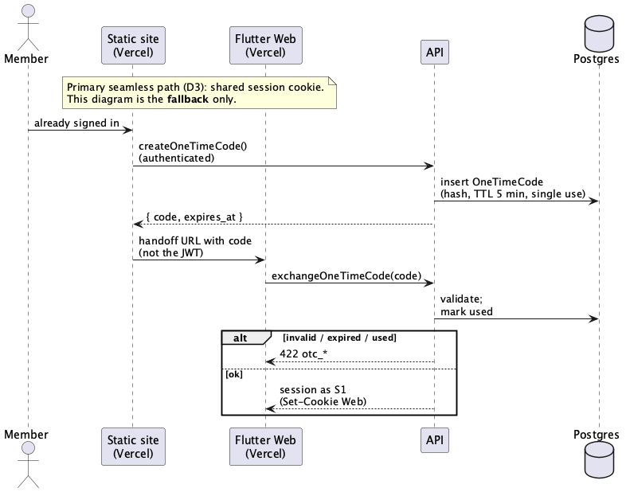
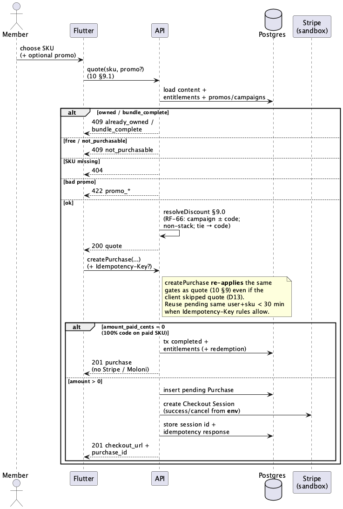
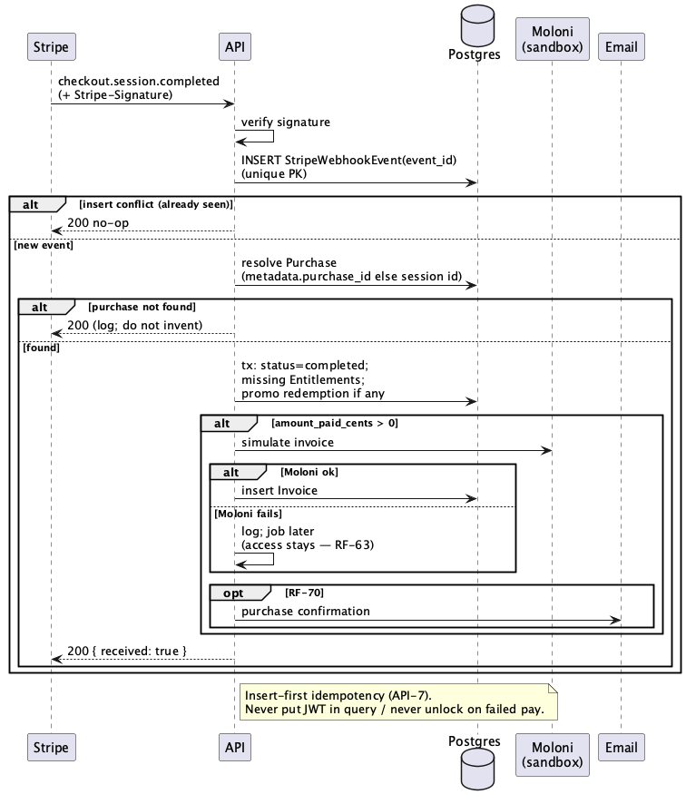
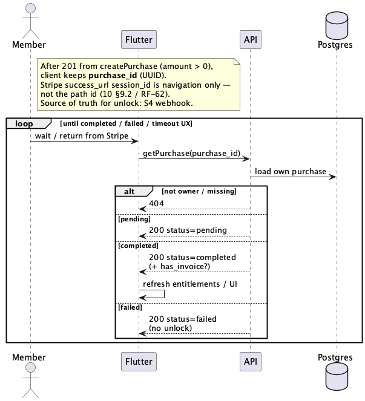

# UML Diagrams – _The Doghouse_

## 1. Introduction

This document gathers **UML that supports implementation**: a **domain class** diagram and **sequence** diagrams for the flows that hurt most if misread (auth, seamless fallback, checkout, Stripe webhook, purchase poll).

**Sources of truth:** [`09_DATABASE.md`](09_DATABASE.md), [`10_API_ENDPOINTS.md`](10_API_ENDPOINTS.md), [`08_ARCHITECTURE.md`](08_ARCHITECTURE.md), [`02_PERSONAS_AND_FLOWS.md`](02_PERSONAS_AND_FLOWS.md).

**Living document:** closed against frozen RN/RF/D*/API-* / DB-*; lifeline labels and minor step wording may be refined during implementation. Rule changes propagate to `07` / `08` / `09` / `10`.

**Conventions:**

- PlantUML sources (`.puml`); PNG renders alongside under [`diagrams/`](diagrams/).
- Classes = **API domain** (not a 1:1 SQL mirror). The ER stays in [`09`](09_DATABASE.md).
- Sequences = **one file per flow** (readability). This markdown is the index + short reading notes.
- **Do not duplicate:** architecture context → [`08`](08_ARCHITECTURE.md) / [`08_context`](diagrams/plantuml/08_context.puml); use cases → [`02`](02_PERSONAS_AND_FLOWS.md) / [`02_usecase`](diagrams/plantuml/02_usecase.puml); ER → [`09_er`](diagrams/plantuml/09_er.puml).

---

## 2. Index

| Group | ID | Diagram | Source |
| ----- | -- | ------- | ------ |
| Domain | C1 | Classes | [`diagrams/plantuml/11_classes.puml`](diagrams/plantuml/11_classes.puml) |
| Auth | S1 | Magic link | [`diagrams/plantuml/11_s1_magic_link.puml`](diagrams/plantuml/11_s1_magic_link.puml) |
| Auth | S2 | Seamless OTC (fallback) | [`diagrams/plantuml/11_s2_otc_seamless.puml`](diagrams/plantuml/11_s2_otc_seamless.puml) |
| Checkout | S3 | Quote → purchase | [`diagrams/plantuml/11_s3_checkout.puml`](diagrams/plantuml/11_s3_checkout.puml) |
| Post-pay | S4 | Stripe webhook → entitlements | [`diagrams/plantuml/11_s4_webhook_stripe.puml`](diagrams/plantuml/11_s4_webhook_stripe.puml) |
| Post-pay | S5 | Poll `GET /purchases/{id}` | [`diagrams/plantuml/11_s5_poll_purchase.puml`](diagrams/plantuml/11_s5_poll_purchase.puml) |

---

## 3. C1 — Domain classes

**Source:** [`diagrams/plantuml/11_classes.puml`](diagrams/plantuml/11_classes.puml)

_Figure C1 – API domain. `Content` → `Breed` is **0..1** (videos require a breed; `calculator_complete` does not — **09**). `MagicLink` → `User` is **0..1** (email-first). `thumbnailUrl` is an **API response** field (**API-4**), not a DDL column. Workshop bundles use `BundleItem` (parent `bundle`, child `video` only — **DB-11**). `WeightHistory` is optional (**RF-34**, **DB-10**)._

**Quick read for Go:**

| Idea | Implication |
| ---- | ----------- |
| One SKU per checkout | `Purchase` points at one `Content` (video, bundle, or calculator) |
| Breed on content | Optional FK; enforce “video ⇒ breed” in API/DB checks, not as UML `1` |
| Bundle | Expand via `BundleItem` → grant missing **video** `Entitlement`s only |
| Free content | No `Entitlement` row; not a checkout target (**API-6**) |
| Discounts | `PromoCode` / `DiscountCampaign` N:N targets; resolve on server (**RF-66**, **API-5**) |
| Idempotency | `CheckoutIdempotencyKey` + `StripeWebhookEvent` (insert-first — **API-7**) |

---

## 4. Auth

### 4.1. S1 — Magic link

**Source:** [`diagrams/plantuml/11_s1_magic_link.puml`](diagrams/plantuml/11_s1_magic_link.puml) · contracts [`10`](10_API_ENDPOINTS.md) §4.1–4.2 · **RF-14**, **RF-15**

_Figure S1 – Request link → email → consume (15 min, single use) → session. Web: `Set-Cookie`; native: Bearer JWT in JSON (**D2**). Consume errors: **422** (`magic_link_*`). Request rate limit: **429**. Welcome email optional when `created_now` (**RF-19**). Google/Facebook OAuth and cold-start UX live in [`08`](08_ARCHITECTURE.md) — not duplicated here._

### 4.2. S2 — Seamless OTC (fallback)

**Source:** [`diagrams/plantuml/11_s2_otc_seamless.puml`](diagrams/plantuml/11_s2_otc_seamless.puml) · [`10`](10_API_ENDPOINTS.md) §4.5 · **D3**, **RF-20**, **RF-21**

_Figure S2 – One-time code, TTL **5 minutes**, public exchange on Flutter Web. Primary seamless path remains the shared Vercel cookie. Never put the JWT in the query string. Exchange errors: **422** (`otc_*`)._

---

## 5. Checkout

### 5.1. S3 — Quote → purchase

**Source:** [`diagrams/plantuml/11_s3_checkout.puml`](diagrams/plantuml/11_s3_checkout.puml) · [`10`](10_API_ENDPOINTS.md) §9 · **RF-64…RF-68**, **D13**

_Figure S3 – Single diagram with `alt`: **409** (owned / free) · **404** · **422** (promo) · **0 EUR** completed without Stripe/Moloni · **&gt; 0 EUR** pending + Checkout Session (success/cancel URLs from **server env**). Discount resolution = §9.0 / **RF-66**. `createPurchase` **re-applies** the same gates as quote even if the client skipped quote (**D13**, [`10`](10_API_ENDPOINTS.md) §9). `Idempotency-Key` and pending reuse noted on the API._

---

## 6. Post-payment

### 6.1. S4 — Stripe webhook

**Source:** [`diagrams/plantuml/11_s4_webhook_stripe.puml`](diagrams/plantuml/11_s4_webhook_stripe.puml) · [`10`](10_API_ENDPOINTS.md) §10 · **RF-62**, **RF-63**, **RNF-12**

_Figure S4 – Happy path for `checkout.session.completed`: verify signature → **insert** `event_id` first (conflict = no-op) → resolve purchase → entitlements → Moloni only if amount &gt; 0 (failure does not reverse access). Optional purchase confirmation email (**RF-70**). Other v1 events from [`10`](10_API_ENDPOINTS.md) §10 (not drawn): `checkout.session.expired` and `checkout.session.async_payment_failed` mark a still-`pending` purchase as **`failed`** (no unlock)._

### 6.2. S5 — Purchase poll (plan B)

**Source:** [`diagrams/plantuml/11_s5_poll_purchase.puml`](diagrams/plantuml/11_s5_poll_purchase.puml) · [`10`](10_API_ENDPOINTS.md) §9.3 · **RF-62**

_Figure S5 – UI keeps the `purchase_id` UUID from the create-purchase **201** and polls with that id. The Stripe `session_id` on the success URL is navigation only — not the path parameter. Unlock source of truth remains S4._

---

## 7. Out of scope for this document

| Topic | Where it lives |
| ----- | -------------- |
| Google / Facebook OAuth + cold start 3 s | [`08_ARCHITECTURE.md`](08_ARCHITECTURE.md) |
| Use cases (visitor / free / paying) | [`02_PERSONAS_AND_FLOWS.md`](02_PERSONAS_AND_FLOWS.md) |
| ER / SQL | [`09_DATABASE.md`](09_DATABASE.md) + [`sql/09_schema.sql`](sql/09_schema.sql) |
| Full HTTP contracts | [`10_API_ENDPOINTS.md`](10_API_ENDPOINTS.md) |
| Calculator evaluate / hotels map | [`10`](10_API_ENDPOINTS.md) §7–§8 — no dedicated sequence in v1 (risk concentrated on auth + checkout) |
| Logout / trivial GETs | [`10`](10_API_ENDPOINTS.md) — too thin for a sequence |
| Media URL gate detail | [`10`](10_API_ENDPOINTS.md) §6.1.1 (**API-4**) |

Locks / `FOR UPDATE` on promo redemption: note in implementation of S3/S4; no separate S6.

---

## 8. Status

UML support for the planned first version is **aligned**: **C1** + **S1–S5** consistent with `09` / `10` (including Content↔Breed **0..1** and email-first MagicLink).
