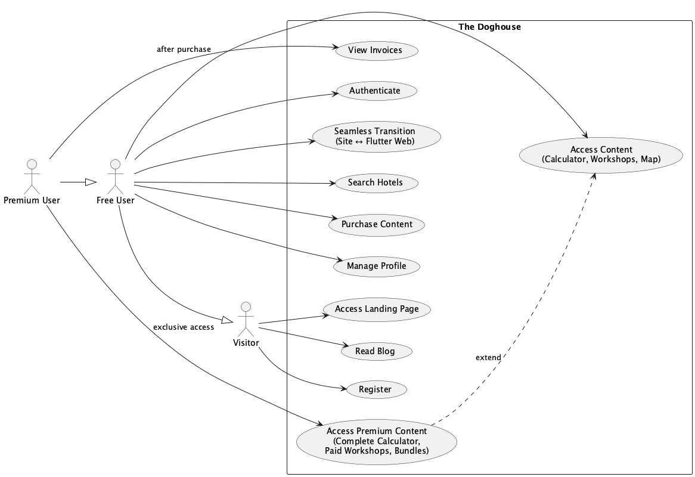

# Design Report – The Doghouse

This report is a **self-contained** design snapshot. You should understand *how* the first version will be built — personas, catalogue prices, requirements spirit, architecture, data model, API contracts, and essential UML — without opening other files. There is no external paying client and no commercial acceptance block. Identity, version, and publication status are in the **Document status** table at the end.

This document freezes the *how* immediately **before** implementation of the delivery track. It does not claim that product code already exists; the next calendar step after this design package is Delivery 1 (institutional website) and a review of that delivery’s acceptance criteria.

---

## 1. What this document is

The Doghouse is a **public simulation** of product-and-engineering work: an institutional website and a members’ area shaped like a real product for dog owners, with passwordless authentication, payments and invoicing in **sandbox**, workshops, an ideal-weight calculator, and a pet-friendly hotels map. Commerce runs through **Stripe** and **Moloni** in sandbox so the sell-and-invoice path works *as if* it were real. Reusers may later point their own secrets at live providers; that reuse path is intentional and is not what this public project itself commits to operate.

A short context paragraph: related private work (for example **Doses Pediátricas**) cannot be exposed here. This public dog-care domain lets me practise the same class of problems in the open. Engineering narrative may later appear under **The Pharmacist, but tech**. Those names may appear in documentation for context; they do not appear in the shipping Doghouse user interface.

The **proposal report** for this project fixed the *what*: soft product brief, Deliveries 1–7, effort envelope, sandbox stance, and exclusions. This **design report** answers a different question: *do we accept that it will be built this way?* Where the design names concrete decisions (session, hosts, HTTP contracts, schema rules, catalogue prices), those decisions become the implementation reference until a conscious written change.

---

## 2. Relation to the proposal

The proposal committed to an institutional site (HTML/CSS/JS) plus a Flutter members’ area (Web PWA, iOS, Android); a Go REST API and PostgreSQL; Stripe and Moloni in **sandbox**; transactional email for magic links; passwordless auth (magic link and/or Google and/or Facebook — no email-and-password, no Apple Sign-In in v1); one-time purchases and bundles with **no** monthly subscription; launch workshops (**2 free** + **4 paid**); a free and a complete calculator; a hotels map for signed-in members via Overpass without a booking marketplace; and delivery order 1→7 with usable first version ≈ Deliveries 1–7 Done.

This design **does not reopen** that effort envelope (about **420 h** usable v1; about **591 h** full package with validation, report, and contingency). It confirms the same stack family, the same product rules, the same EUR catalogue below, and the same delivery order. What changes is the level of commitment: the proposal said *we will build this*; this report says *we will build it like this*.

---

## 3. Catalogue prices (EUR, v1)

Commerce in this design is closed only if the reader can see every sellable SKU price here. Currency is **EUR**. Amounts in the API and database are **integer cents** (for example 490 = 4.90 EUR). Free items are **0.00 EUR** and are not checkout targets.

| SKU (product) | Catalogue price | Notes |
| ------------- | --------------- | ----- |
| Free (basic) calculator | **0.00 EUR** | All signed-in members; not sold |
| Complete calculator | **9.90 EUR** | Lifetime access; independent of workshops |
| Individual paid workshop video | **4.90 EUR** | Lifetime access to that video |
| Breed bundle | **12.90 EUR** | All paid videos for that breed as designed |
| Complete present bundle | **24.90 EUR** | All paid workshop videos existing at purchase time |
| Free workshop intros (launch: **two**) | **0.00 EUR** | Signed-in members; not sold |
| Hotels map | **0.00 EUR** | Signed-in members; no purchase required |

**Commerce rules that travel with this catalogue:** no monthly subscription; **no refunds**; calculator and workshops stay **independent** catalogues (a workshop bundle never contains the calculator); buying one item never silently unlocks unrelated items; partial bundle ownership charges the **full** bundle catalogue price and grants only **missing** entitlements; optional promo codes and automatic campaigns **do not stack** (higher percent wins; tie prefers the code); checkout at **0.00 EUR** grants access without Stripe and without a Moloni invoice.

---

## 4. What the market teaches the design

Five public references shaped the lessons: **Barkyn** (personalisation and content), **Buddy Vets** (education + calculator, indirect), **FLUTO** (weight tools and explorer map), **Pet Mate** (trust/auth hygiene only — social stays out of v1), and **BringFido** (pet-friendly hotels UX and low-friction auth patterns).

From that reading, the design keeps a static blog next to tools (no comment product); low-friction magic link plus Google and Facebook (**not** Apple Sign-In); a simple free calculator door and a richer paid result; workshops structured by breed with free intros and paid depth; a hotels map that is reliable rather than a full POI explorer; and freemium as **free tier + paid-per-purchase**, never a monthly subscription.

**Differentiation this design protects:** one consumer ecosystem (site + calculator + workshops + map + account), sandbox commerce as a teaching product, multiplatform Flutter, and the explicit non-goals listed in §5.3.

---

## 5. Personas and flows

Three personas, by access level. There is **no** in-product administrator in v1 — content is placed directly. Names below match the use-case diagram (Figure 1): **Visitor**, **Free User**, and **Premium User**. “Premium” means the member has purchased **one or more** items — not a global premium flag.

| Persona | Who | Access |
| ------- | --- | ------ |
| **Visitor** | Not signed in | Landing + blog only |
| **Free User** | Signed in, no paid SKUs yet | Free calculator, two free workshop intros, hotels map, profile, start purchase |
| **Premium User** | Owns one or more paid SKUs | Everything a Free User has + lifetime access to purchased items + invoices for those purchases |

Access is **per item**. Buying the complete calculator does not unlock paid workshops; buying a workshop does not unlock the calculator. The hotels map never requires a purchase once the user is signed in.

The design must support registration and authentication (magic link valid **15 minutes**, single use, or Google / Facebook); seamless navigation from the static site to Flutter Web for members **already** signed in (native apps sign in inside the app); use of free content and purchase of premium content (including partial-bundle rules); hotels search (Near me after consent, or text geocode) with open-in-maps; and viewing simulated invoices after paid checkout.

_Figure 1 – Use-case diagram. Actors: Visitor, Free User, and Premium User (generalisation). Main cases: landing and blog, registration, authentication, seamless site↔Flutter Web, free and premium content, hotel search, purchase, invoices, profile._

**Closing note.** Personas fix *who* may do *what*. Requirements (§6) turn that into Must/Should/Could; architecture (§7) turns it into hosts, session, and authority.

---

## 6. Requirements (design commitment)

Priorities: **Essential / Must** (piece not done without it), **Important / Should** (same wave or the next), **Optional / Could** (conscious backlog that does not block Done).

### 6.1. Must / Should / Could (portfolio reading)

| Must | Should | Could |
| ---- | ------ | ----- |
| English site/blog; no foreign brands in UI; mobile-first; HTTPS | Profile edit; welcome email | Saved calculator history (weight history) |
| Magic link + Google + Facebook; JWT 7 days; seamless Web vs native | Purchase confirmation email | Advanced map features beyond hotels discovery |
| Free calculator + CTA to complete; complete at **9.90 EUR** | Search Console / SEO polish after the site ships | Optional Sentry error tracking |
| Workshops by breed; 2 free + 4 paid; prices in §3; no future-video SKU | — | — |
| Signed-in hotels map (Overpass viewport, 24 h cache, consent) | — | — |
| Stripe + Moloni sandbox; entitlements; non-stacking discounts; 0 EUR path | — | — |
| Shared Flutter; store **publication path** (Play download; App Store best effort); secrets out of Git | — | — |

App Store **approval** remains best effort: Web PWA plus the Play download path still define store-line Done. Sentry is Could — useful if enabled, never required for delivery Done.

### 6.2. Out of scope for v1 (not Could)

These are **exclusions**, not backlog options:

- In-product administrator UI (content is placed directly)
- Monthly subscription
- Email-and-password authentication; Apple Sign-In
- Article comments; in-product social network; live support chat
- Languages other than English in the product
- Hotel reviews or a booking marketplace
- Store IAP (Apple/Google) for these catalogue SKUs
- Cross-catalogue packages (calculator + workshops in one SKU)
- SKU that sells unpublished **future** workshop videos
- Advanced visit analytics as a v1 requirement (attribution may stay imperfect; this is a premise, not a Should)

### 6.3. Functional spirit by delivery

| Delivery | What must work |
| -------- | -------------- |
| **1** Institutional site | Landing, blog without login, clear path to members’ area, English, no other brands in UI |
| **2** Backend + auth | Magic link + Google + Facebook; session; seamless Web; native Bearer; profile |
| **3** Free calculator | Breed + age → approximate ideal weight; CTA toward complete |
| **4** Hotels map | Viewport Overpass hotels; Near me / text; open in maps; signed-in only |
| **5** Free workshops | Two free intros by breed; paid items visible but locked |
| **6** Payments + premium | Sandbox checkout; unlock only purchased; Moloni when amount &gt; 0; complete calculator + paid videos/bundles at §3 prices |
| **7** Stores | Exercise Play download path; App Store best effort |

### 6.4. Non-functional spirit

HTTPS; responsive touch-first UI; secrets in environment variables; API as authority (UI helps, server revalidates); unit and end-to-end tests on critical flows; security pass when a delivery changes an attack surface; free-tier cold starts accepted with honest UX; sandbox invoices have no legal/tax effect in this public project.

**Closing note.** Must items gate each delivery’s Done. Should items may slip one wave with an explicit trade-off. Could items never block usable v1. Exclusions in §6.2 stay out unless a written change reopens the proposal.

---

## 7. Architecture

### 7.1. Principles

The stack is fixed: static site HTML/CSS/JS; members’ area Flutter; API Go; PostgreSQL; Stripe and Moloni sandbox; Resend for transactional email. Prefer free hosting tiers while sustainable. Solo operation favours simple deploys and secrets. The interface owns experience; the **backend owns authority** — forging a screen or a request does not bypass session, price, or entitlement rules.

### 7.2. Closed hosting and session decisions

The table below is the freeze for implementers. In prose: one **JWT** lasting **seven days**, carried as an **HttpOnly Secure cookie** on Web and as **Bearer** on native; seamless site→Flutter Web prefers a **shared Vercel cookie**, with a **one-time code** only as fallback; auth go-live ships **magic link, Google, and Facebook** together; the API lives on **Render** free (Docker), data on **Neon**, site and Flutter Web on **Vercel**; email via **Resend**; payments via Stripe/Moloni **sandbox**; cold starts are accepted with a **3-second** wake-up notice and a recoverable **60–90 s** timeout that must never look like wrong credentials.

| ID | Topic | Decision |
| -- | ----- | -------- |
| D1 | Session | Single **JWT**, **7 days**, renewed on re-authentication (no access+refresh split in v1) |
| D2 | Transport | **Web:** `HttpOnly` + `Secure` cookie (`SameSite=Lax` unless a documented exception). **Native:** `Authorization: Bearer` only |
| D3 | Seamless site → Flutter Web | **Primary:** shared cookie on the **Vercel** parent domain. **Fallback:** short-lived one-time code (single use) exchanged at the API — never put the JWT in the query string |
| D4 | Auth at Delivery 2 go-live | Magic link **and** Google **and** Facebook together |
| D5 | API host | **Render** Web Service, free plan, Docker image |
| D6 | Cold start UX | No HTTP response within **3 s** on login → wake-up notice; keep waiting; recoverable timeout ~**60–90 s** |
| D7 | Keep-alive ping | **Out** of plan A |
| D8 | Site + Flutter Web | **Vercel** (same project / shareable parent domain for cookies) |
| D9 | Database | **PostgreSQL on Neon** (free tier) |
| D10 | Payments | Stripe sandbox + Moloni sandbox; same catalogue on Web and native; **no** store IAP for these SKUs |
| D11 | Email | **Resend** (magic link; optional welcome / purchase confirmation) |
| D12 | Error tracking | **Sentry** optional (Could — §6.1) |
| D13 | Authority | Backend revalidates session, SKUs, entitlements, discounts |
| D14 | Plan B | If Render free stops serving the product, evaluate another cheap host — without abandoning plan A while it works |

### 7.3. Components and figure

The **institutional site** on Vercel publishes landing and blog and steers people into sign-in or the members’ area, without payment secrets in the browser. The **Flutter** members’ area covers calculator, workshops, hotels map, profile, purchases, and invoices — cookie on Web, Bearer on native. The **Go API** on Render owns auth, catalogue, entitlements, checkout, webhooks, Overpass proxy/cache, Nominatim, and email triggers. **Neon** holds persistent data. Externals are Resend, Google/Facebook OAuth, Stripe sandbox, Moloni sandbox, Overpass, and Nominatim.

_Figure 2 – Context of the planned first version: dog owner, static site and Flutter Web (Vercel), native apps, Go API (Render), Neon, Resend, Google/Facebook, Stripe sandbox, Moloni sandbox, Overpass/Nominatim._

### 7.4. Payments and request granularity

A signed-in user starts checkout; the API refuses an identical owned SKU; discounts resolve on the server; **0.00 EUR** completes without Stripe or Moloni; amount greater than zero creates Stripe Checkout; an idempotent webhook grants entitlements; Moloni runs only when amount &gt; 0 and failure does not reverse access; the client may poll purchase status if the webhook is delayed.

Screens that need several resources at once use one **aggregate** (`GET /me/home`). Single-resource screens and all writes use **small, specific** requests. The client must not build the first authenticated screen with a long chain of serial GETs — especially painful after a free-tier cold start.

**Closing note.** Architecture answers *where* each piece runs and *who* decides. The data model (§8) answers *what* is stored; the API (§9) answers *which* HTTP operations expose that behaviour.

---

## 8. Data model

Money is stored as **integer cents**. The session JWT is **not** persisted in the database. Paid access is a row in **`entitlements`** (lifetime, per user and content); free SKUs need **no** entitlement row. Workshop bundles expand to **video** children only — the complete calculator is never a bundle member. Zero-euro checkouts complete without Stripe identifiers and without an invoice row. Promo codes and campaigns live in the schema and are operated by script in v1. Stripe webhook event ids are unique for idempotency; checkout uses client idempotency keys. Overpass responses may be cached with a **24-hour** TTL policy. Weight history may exist in the schema even if the product UI omits it in v1 (Could).

| ID | Topic | Decision |
| -- | ----- | -------- |
| DB-1 | Money | **INTEGER cents**; currency default EUR |
| DB-2 | Session | **No** JWT table — cookie / Bearer only |
| DB-3 | Seamless fallback | Persist hashed short-lived **one-time codes** |
| DB-4 | Access | Table **`entitlements`** for **paid** lifetime unlocks; free SKUs need **no** entitlement row |
| DB-5 | 0 EUR checkout | Completed purchase + entitlements without Stripe ids and without invoice row |
| DB-6 | Commercial snapshot | Catalogue price, discount type/percent, optional code/campaign, amount paid |
| DB-7 | Promos | Codes + campaigns with per-SKU links; non-stacking resolved in the API |
| DB-8 | Stripe | Webhook `event_id` uniqueness; checkout idempotency keys |
| DB-9 | Maps cache | Overpass cache with TTL **24 h** policy |
| DB-10 | Weight history | Optional table; product UI may omit persistence in v1 |
| DB-11 | Bundles | Parent `bundle`, children **`video` only** — calculator stays a separate catalogue |

Conceptually the model covers users and auth (users, magic links, one-time codes); catalogue (breeds, calculator data, contents, bundle items); commerce (purchases, entitlements, invoices, promos, webhook events, idempotency keys); maps cache; and optional weight history. Full DDL belongs to implementation execution; with this chapter and Figure 3, a reader can accept the model without a separate SQL listing.

_Figure 3 – Relational model of the planned first version. Convention: the “one” side of each relationship sits above the “many” side._

**Closing note.** Schema decisions above are normative for v1. Changing money representation, entitlement semantics, or bundle composition is a design change, not a silent implementation tweak.

---

## 9. Service interfaces (API)

The Go API sits on its own host. Paths stay clean (`/auth/…`, `/me/…`, `/checkout/…`) — **no** `/v1` and **no** `/api` prefix, because the API host already separates API from the site. JSON fields are English; money is integer cents. Errors use `{ "error": { "code", "message" } }`; another user’s resource typically returns **404**. Web clients send the session cookie; native clients send Bearer JWT. The backend ignores client-invented prices and discount types and **recalculates**. Playback `media_url` is returned only when access is `free` or `owned`; thumbnails may be open to signed-in members. Free SKUs are not checkout targets (**409** `not_purchasable`). Stripe webhooks insert `event_id` first; a conflict is a no-op.

| Product question | Operation |
| ---------------- | --------- |
| Bootstrap signed-in home | `GET /me/home` (aggregate) |
| Profile | `GET /me` · `PATCH /me` |
| What do I own? | `GET /me/entitlements` (or via home) |
| Catalogue + access state | `GET /contents` · `GET /contents/{sku}` |
| Free vs complete calculator | `POST /calculator/evaluate` |
| Hotels / geocode | `GET /hotels` · `GET /geocode` |
| Price preview | `POST /checkout/quote` |
| Start purchase | `POST /checkout/purchases` (idempotency key) |
| Poll purchase | `GET /purchases/{id}` |
| My invoices | `GET /me/invoices` |
| Magic link | `POST /auth/magic-link` · consume route |
| Google / Facebook | OAuth completion routes |
| Seamless fallback | `POST /auth/one-time-code` · exchange |
| Stripe confirmation | `POST /webhooks/stripe` |

Campaigns and promo codes in v1 are operated by script or console against the database — not a public admin API. Quote resolves automatic campaign and optional code; higher percentage wins; tie prefers code. Create-purchase re-applies the same gates even if the client skipped quote. Paths cover already owned, free SKU, invalid promo, 0 EUR completed, and amount &gt; 0 pending with Checkout Session. Success and cancel URLs come from **server environment** only.

**Closing note.** The map above is enough to accept the *shape* of the contract. Fine field lists may refine during implementation without changing these product questions, authority rules, or status codes’ meaning.

---

## 10. Essential UML

Beyond the use-case and context figures above, the design fixes one domain class diagram and five sequences — the flows that hurt most if misread: magic link, seamless fallback, checkout, webhook unlock, and purchase poll.

_Figure 4 – API domain. Content→Breed is 0..1 (videos require a breed; complete calculator does not). Workshop bundles expand to video entitlements only. Discounts and idempotency keys live on the server._

_Figure 5 – Request link → email → consume (15 minutes, single use) → session. Web: Set-Cookie; native: Bearer JWT in JSON._

_Figure 6 – One-time code, TTL 5 minutes, public exchange on Flutter Web. Primary seamless path remains the shared Vercel cookie._

_Figure 7 – Alternate paths: already owned / free / invalid promo / 0 EUR / amount &gt; 0 with Stripe Checkout._

_Figure 8 – Verify signature → insert event id first → grant entitlements → Moloni only if amount &gt; 0 (failure does not reverse access)._

_Figure 9 – Client polls by purchase id from create-purchase; unlock source of truth remains the webhook path._

**Closing note.** Figures 4–9 are normative for the risky paths. Calculator evaluate and hotels list are covered by the API map; they do not need separate sequences for v1 acceptance of this design.

---

## 11. Position in the plan

The proposal scheduled design before Deliveries 1–7. **This design package is complete.** Position on that plan:

> Design package complete; next work is **Delivery 1** (institutional website) and a **review** of that delivery’s acceptance criteria — then continue Deliveries 2–7 as proposed.

Reference delivery order (unchanged from the proposal): (1) institutional website; (2) backend with authentication and members’ shell; (3) free calculator; (4) hotels map; (5) free workshops; (6) payments, premium content, sandbox invoicing; (7) store publishing path.

Usable first version = Deliveries 1–7 Done. Cross-cutting validation sits after that checkpoint. Solo calendar arithmetic remains the proposal’s.

---

## 12. Premises and technical risks

**Assumed:** proposal stance accepted for this public simulation; solo execution interleaved with other work; free-tier hosts adequate at start; sandbox Stripe/Moloni; Resend available when auth ships; single decision-maker; product rules and §3 prices frozen as in this design.

**Planning risk absorbed by the author** (does not rewrite the proposal’s effort fiction): underestimated technical complexity, own defects, small refinements that do not change Done criteria.

**Conscious change requests:** new features or rule changes against this design or the proposal; operating this public project in live money mode; adding admin UI, subscriptions, or other brands in the shipping UI; expanding the launch workshop inventory as a closed obligation; changing the §3 catalogue prices.

**Accepted as designed, not as gaps:** App Store as best effort; exact OAuth provider mix enabled at go-live within the three allowed methods; fine map package choices inside the hotels envelope; cold-start delay on free API hosting, handled in login UX; **advanced analytics not required in v1** (measurement may stay incomplete).

---

## 13. Critical glossary (terms used in this report)

**Access / entitlement** — lifetime unlock of one paid SKU for one user; free SKUs need no entitlement row.  
**Cold start** — free-tier API wake delay; login UX notice at ~3 s, wait up to ~60–90 s.  
**Complete calculator** — paid SKU at **9.90 EUR** with richer results; independent from workshop catalogue.  
**Complete present / breed bundle** — workshop packages at **24.90 EUR** / **12.90 EUR**; children are videos only.  
**Discount campaign / promo code** — two non-stacking mechanisms; higher percent wins; tie → code.  
**Free User / Premium User** — signed-in without paid SKUs vs signed-in with at least one paid SKU (per-item access).  
**Integer cents** — all money as integers (e.g. 490 = 4.90 EUR).  
**JWT (7 days)** — single session token; Web cookie; native Bearer.  
**Magic link** — email auth, 15 minutes, single use.  
**One-time code (OTC)** — seamless fallback site→Flutter Web, ~5 minutes, single use.  
**Overpass** — OpenStreetMap query layer for pet-friendly hotels in the current viewport.  
**Sandbox** — Stripe/Moloni test mode; no real charges or fiscal invoices operated by this public project.  
**Seamless** — signed-in static site opens Flutter Web without signing in again.  
**SKU** — stable catalogue identity (video, bundle, or calculator_complete).  
**0 EUR checkout** — access without Stripe and without Moloni invoice.

---

## 14. Criteria for accepting this design

A reader accepts this design if, with **only** this document and its nine figures, they understand and agree with: the relation to the proposal; the **full EUR catalogue** in §3; the market lessons that justify the pieces; personas (Visitor / Free User / Premium User); Must/Should/Could and the explicit out-of-scope list; architecture (hosts, session, seamless, cold start, payments, granularity); data-model decisions and ER; API map and authority rules; essential UML sequences; plan position (next = Delivery 1 review); and premises/risks.

Accepting authorises implementation along the proposal’s delivery order under these technical decisions. Rejecting or accepting with reservations that change decisions implies a new version of this report. Silence is **not** acceptance — publication status is recorded explicitly below.

---

## 15. Closing

The first version of The Doghouse is designed as a public sandbox simulation: Vercel (site + Flutter Web) + Flutter native + Go on Render + Neon + Resend; magic link with Google and Facebook; 7-day JWT with cookie seamless Web and OTC fallback; Stripe/Moloni sandbox with entitlements and honest failure paths; catalogue prices frozen in §3; Overpass hotels for signed-in members; and UML coverage of the risky auth and checkout flows.

Effort and calendar from the proposal are **not** renegotiated here. Implementation starts at Delivery 1 after this design snapshot.

---

## Document status

| Field | Value |
| ----- | ----- |
| Document | Design report – first version (*MVP*) – The Doghouse |
| Project | The Doghouse |
| Document date | 2026-10-26 |
| Version | 1.1 |
| Status | Published |
| Author | Jaime Mendonça |
| Audience | Public repository visitors — engineers and recruiters |

**Notes:** Snapshot of the design track for a public sandbox simulation, immediately before the delivery implementation track. No commercial acceptance checkboxes or signatures. Aligns with the proposal report (version 1.1) and the frozen product brief from the simulated product-owner interview. Figures 1–9 are embedded above. Version **1.1** adds the full EUR catalogue, separates MoSCoW Could from out-of-scope exclusions, unifies persona labels with Free User / Premium User, and strengthens dossier prose around decision tables. Alignment review closed at version **1.1**.

---

## Bibliography

1. Flutter documentation. https://docs.flutter.dev/  
2. The Go Programming Language documentation. https://go.dev/doc/  
3. PostgreSQL documentation. https://www.postgresql.org/docs/  
4. Stripe API documentation (Checkout, webhooks). https://docs.stripe.com/  
5. Resend documentation. https://resend.com/docs  
6. OpenStreetMap Overpass API. https://wiki.openstreetmap.org/wiki/Overpass_API  
7. Nominatim usage policy / geocoding. https://nominatim.org/  
8. OWASP Top Ten. https://owasp.org/Top10/  
9. Fielding, R. T. (2000). *Architectural styles and the design of network-based software architectures* (Doctoral dissertation). University of California, Irvine.

---

*End of design report.*
